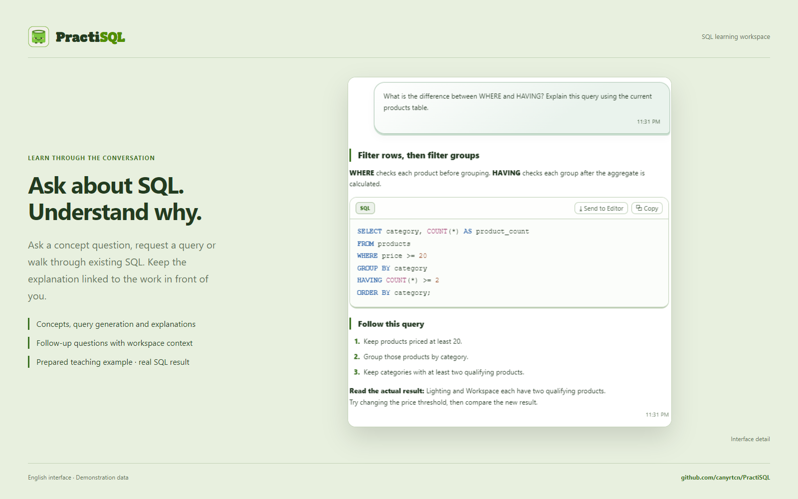
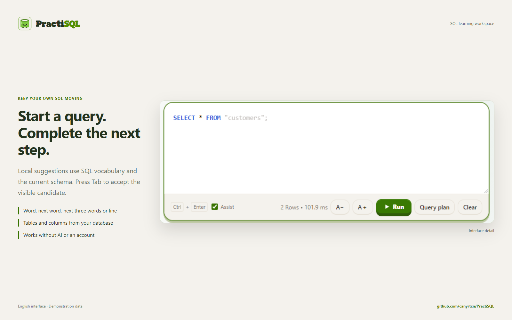
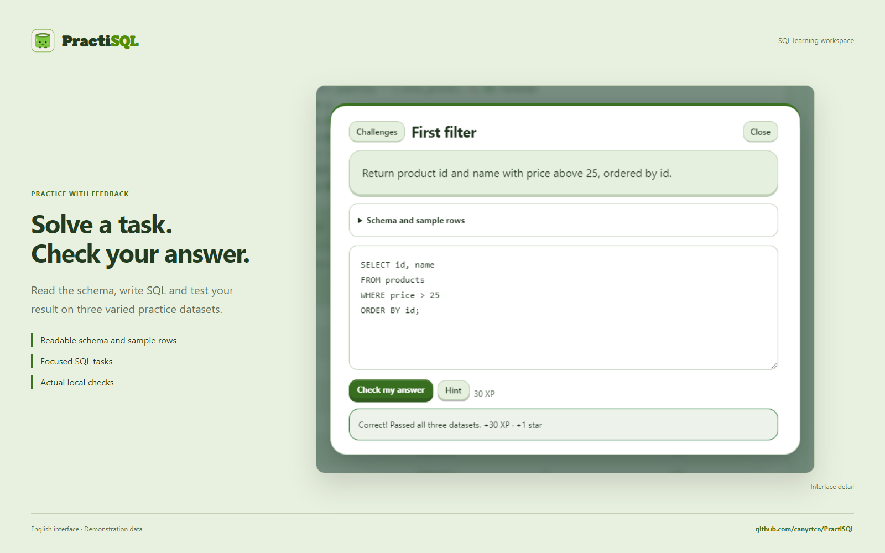
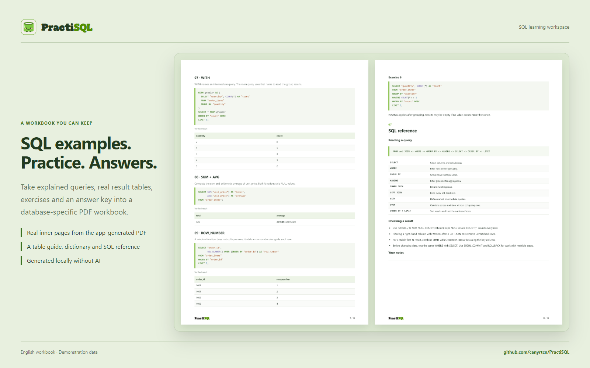
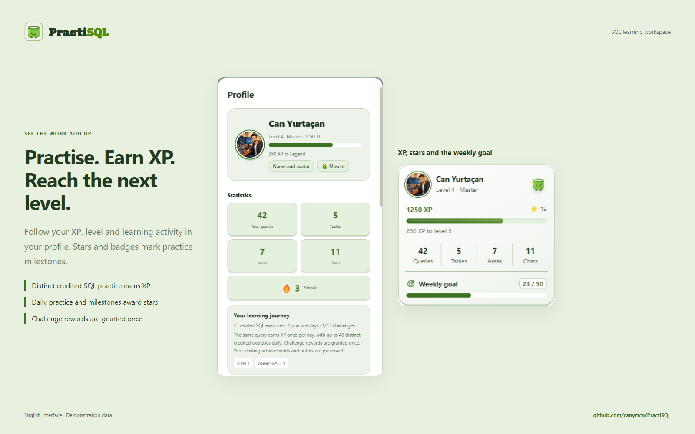
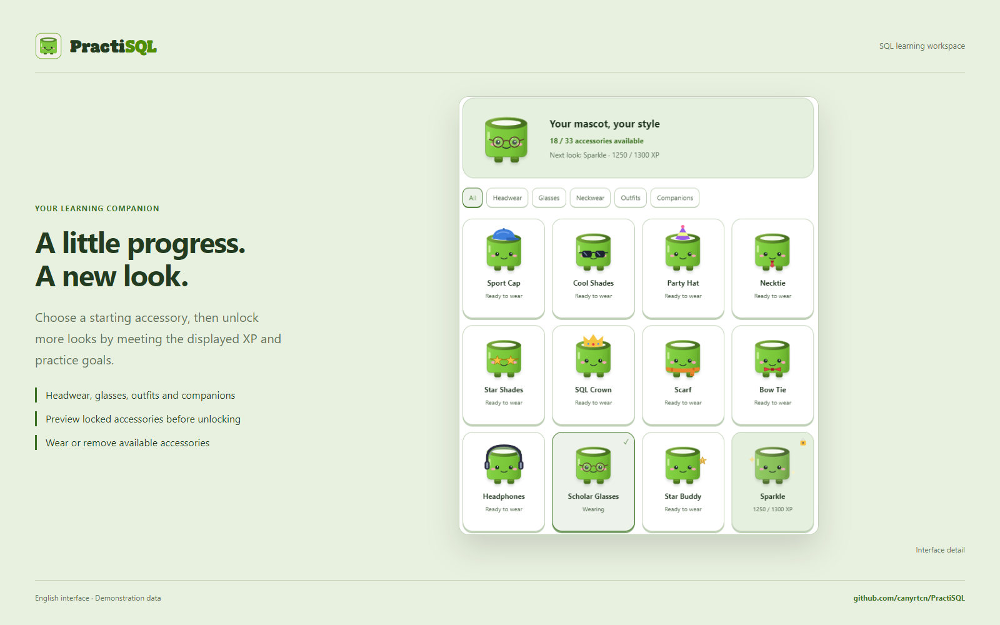

<p align="right"><a href="README.tr.md"></a></p>

<p align="center"><picture><source media="(prefers-color-scheme: dark)" srcset="docs/assets/repository-wordmark-dark.svg"></picture></p>

<h3 align="center">Learn SQL. Run it. Understand it.</h3>

A desktop SQL learning workspace that brings local SQLite, an AI tutor, visual schemas and hands-on practice together through a coordinated **AI harness**.

[Ask the tutor](#learn-sql-by-asking-questions) · [Practice](#practise-the-structure-of-sql) · [PDF workbooks](#take-a-complete-study-workbook-with-you) · [AI harness](#the-ai-harness-behind-the-conversation) · [Get started](#get-started)

<a href="https://github.com/canyrtcn/PractiSQL/releases"></a>

**Windows x64 · v3.4.264** · **macOS is in preparation.**

The button opens Releases, where the Windows x64 installer is available. No GitHub account is required to download it.


**Your query, actual results and explanation stay together.** The left pane organizes workspaces and conversations, the centre keeps SQL and result tables in reach, and the right pane brings together the tutor, schema, data tools and lessons. You can start with a built-in example or work with a local database of your own.

**Use it as a SQL playground without AI.** Load a SQLite database, SQL dump or CSV, write your own queries and inspect the actual results. The editor, schema viewer and local completion do not require an AI connection. Connect the tutor when you want explanations or generated SQL.

## Learn SQL by asking questions



**Ask about the concept, the query or the result in front of you.** Ask PractiSQL to explain a JOIN, write a query for your current schema, walk through existing SQL, or explain why a result changed. Follow-up questions stay connected to the workspace and conversation. You can select SQL or quote a specific part of an answer to narrow the next question.

| What you want to learn | A question you can ask |
|---|---|
| Understand a concept | “When should I use WHERE, and when do I need HAVING?” |
| Turn an idea into SQL | “Show completed sales by category using my current tables.” |
| Read someone else's query | “Explain this SQL clause by clause. Only explain; do not run it.” |
| Understand an observed result | “Why did this JOIN produce more rows?” |
| Practise a topic | “Give me three grouping exercises. Keep the solutions for later.” |

The AI harness supplies the relevant schema, conversation and observations, then records what actually ran. Teaching copy in this illustration is prepared demonstration content; the displayed query and result were executed locally.

## Your first session

1. **Open an example or import a database.** Built-in learning workspaces give you tables and records to explore immediately.
2. **Run a query and inspect the rows.** Keep the editor, results and visual schema together as you change the SQL.
3. **Add a tutor when you want one.** Connect a ChatGPT account or an API provider, ask about the result and compare the explanation with the actual table.

## Write SQL and inspect what it does


**Follow the query all the way to its rows.** This example joins products, order items and orders, groups completed sales and calculates quantity and revenue. The table below comes from actual SQLite execution in the application.

Use the editor for your own SQL, inspect a query plan, revisit query history or transfer a code block from the conversation into the editor. Copy and transfer preserve the SQL text. The model's explanation stays beside the work so you can compare its claims with the visible result.

## Keep writing with local SQL completion



**Use Tab to accept a suggestion that follows your current schema.** Choose word completion, the next word, the next three words or the rest of a line. Suggestions use local SQL vocabulary, table names and columns. This editor assistance works without an AI account or model call; asking the tutor to generate SQL is a separate feature.

## Learn a concept, then try it


**Built-in lessons give each SQL concept a place to start.** Follow the learning path, read an explanation, inspect examples and open practice in a separate lesson workspace. The path includes selection, filtering, sorting, joins, grouping and more advanced SQL topics.

Challenges turn those concepts into focused tasks with a schema and sample records. Answers are checked on three practice-data variants. PDF study notes bring lesson material and SQL observations into a document you can keep, with the PractiSQL wordmark and mascot.

## Practise the structure of SQL


**Read the query and supply the missing expression.** Choose 10, 15 or 20 questions and a difficulty. Your selected AI provider prepares synthetic queries; the interface creates a blank for an SQL expression, validates query grammar and reviews the keyword answer locally.

This exercise is about recognizing where a clause or function belongs. It does not send your personal schema or table records to the question generator. Answers and explanations are available when you finish the round.

## Practise with a concrete SQL task



**Move from reading an example to solving a task.** Challenges provide a schema and sample records in a separate practice database. Your answer is checked against three fixture variants, with feedback you can use to revise the query. Your personal workspace is separate from the challenge data.

## Test your understanding and review it


**Exams combine questions, SQL evidence and review.** The schema viewer uses the exam's frozen database snapshot. Read the prompt, complete missing SQL or answer the selected question type, then review the result and feedback. Student SQL is checked on a database copy, and AI judgment is part of grading.

For a fill-in question, a correct optional complete-query answer earns an additional 25 XP. Saved exam history and study workbooks help you return to earlier work; reward tracking prevents repeated rewards for the same question set.

## Turn real data into a useful report


**Work from a documented source to a business question.** The project workflow can explore the official UCI catalogue, inspect a source and clarify a measurable assignment. The source is imported into a separate workspace, where you submit SQL and your interpretation.

Expected numeric results are calculated independently from the original CSV records and measurement specification. AI feedback then considers the business interpretation with the available evidence. Project context, submissions, checks and feedback remain linked, so later discussion can refer to what was actually evaluated.

## Take a complete study workbook with you



**Keep the explanation, the SQL and the practice material together.** The generated workbook includes a table guide, data dictionary, declared relationships, read-only query examples with actual results, exercises, an answer key and a SQL reference. Lesson explanations also have PDF export. The illustration shows real inner pages from an application-generated workbook, including its examples and answer material.

The local workbook is built from your current database without an AI connection. Its sample queries are verified against that database when generated. PractiSQL's wordmark and mascot carry into the document; normal text and SQL retain readable fonts.

## Understand the tables before the JOIN


**See the complete relationship diagram.** The schema viewer shows tables, actual column names, primary and foreign keys, declared relationships and row counts. Zoom, pan and table selection help you follow a connection before writing a JOIN. The illustration above keeps all five demonstration tables inside the frame.

Local SQLite databases and file imports can become learning workspaces. Supported server imports create a local learning copy; they are separate from ordinary query execution against that copy.

## A workspace you can make your own


**Choose Light, Leaf or Dark without changing how you work.** SQL highlighting, Markdown, result tables and learning controls follow the selected theme. English and Turkish interfaces, adjustable pane widths, interface fonts and 75–150% scaling let you adapt the same three-pane workspace to your screen.

The mascot, XP, badges and learning profile add a sense of progress. They sit alongside the work: the centre remains focused on writing queries and reading tables.

## Make practice a habit



**Your profile makes progress visible.** Earn XP through distinct credited SQL exercises, completed lessons and learning activities. Track the next level, badges, practice history and weekly goals. Stars recognize daily practice and defined milestones; repeating the same trivial query is not a shortcut to unlimited XP. Challenge rewards are granted once.

The built-in challenges introduced above give you focused tasks and three dataset variants to test your answer. Return to an unfinished task, inspect feedback and build the skills that unlock later practice goals. Profile values in the illustrations are synthetic demonstration progress.



**Give your companion a look of its own.** Some accessories are available from the start. Others unlock when you meet their displayed XP and, where required, practice or challenge goals. Preview a locked item, see the requirement, then wear or remove an available accessory. Headwear, glasses, neckwear, outfits and companions let the mascot grow with your learning routine.

## The AI harness behind the conversation


**The harness coordinates the path from a question to an observed result.** A request carries its workspace, conversation, database identity, revision and explicit UI action. Teacher instructions, actual schema, relevant history and selected text are assembled separately from the student's latest question.

The model can retrieve an earlier source through `read_context` or examine a captured database through the read-only `inspect_database` tool. Context capacity and output reserves are managed for the chosen model. When older content needs compaction, its original messages, SQL and result sources remain available for retrieval.

| Layer | What PractiSQL coordinates |
|---|---|
| **Request lifecycle** | Scope, cancellation, deadlines and protection against applying a late answer to another workspace or database revision. |
| **Model and tools** | Provider protocols, account transport, tool-call identities, read-only observations and continuations of the same request. |
| **SQL execution** | Separation of runnable SQL from teaching examples; read workers, normal automatic write savepoints, SQLite constraints and applicable preservation checks. |
| **Evidence and memory** | Actual result tables, complete SQL, errors, changes and source identities, including full-result archives for later questions. |
| **Learning workflows** | Lessons, challenges, exams, schema-free exercises and data projects with their own execution and assessment rules. |

Eligible failures can use one shared, conditional repair attempt with the original request and actual error or evidence. Reads, automatic writes and manual transactions have distinct execution contracts. Local checks verify their defined scope; teaching explanations and business interpretations still involve model judgment.

[Explore the architecture and source map](docs/en/architecture.md) · [48 components across eight architecture views](docs/architecture/index.html?lang=en) — open the HTML explorer locally after downloading the source.

### Follow a request from question to result



**Read the numbered path from top to bottom.** The side branches retain conditional context compaction, request-scoped read-only tools, stale-request rejection, separate read/AI-write/manual execution and the single shared repair budget. Actual result archives return as sources for later questions. The separate manual-editor entry does not pass through a model.

[Open the full-size flow](docs/architecture/request-lifecycle.en.svg) · [Execution boundaries and source](docs/en/request-flow.md).


## Connect the AI provider you prefer

**ChatGPT account:** Settings → Provider → ChatGPT Account → Sign in with ChatGPT. Follow the account sign-in flow; this route does not require pasting a separate API key. Model availability, plan eligibility and usage limits depend on your account.

**API providers:** OpenAI, Anthropic Claude, Google AI Studio, DeepSeek, OpenCode Zen & Go, xAI, Moonshot, Zhipu, Cohere, Mistral, Groq, OpenRouter, Together AI, Alibaba Qwen and Perplexity.

Compatible custom HTTP/HTTPS endpoints are also supported. You choose the provider and model; no shared paid key is shipped. AI can receive your question, relevant conversation, schema and necessary observations or result rows. First-run setup explains this before you connect. [Privacy details](docs/PRIVACY.md).

### Recommended models

- **GPT-6 Luna**
- **Muse Spark 1.3**
- **DeepSeek V4.1 Flash**

Choose an available model entry in your account. Model names and access can vary; this list is a recommendation, not a measured quality ranking.

## Get started

1. Open [Releases](https://github.com/canyrtcn/PractiSQL/releases). The Windows x64 installer is available in Releases.
2. Run the installer and choose your language during first-run setup. macOS is in preparation.
3. Load a supported database or file, or open a built-in learning example. Start writing and running SQL immediately.
4. Connect AI when you want guided explanations, generated queries or AI-backed learning workflows. You can leave this step for later.

[Release notes](docs/releases/v3.4.264.md) · [Build from source](#development-and-repository-layout)

## More screens and documentation

[Browse 90 application screens](docs/en/screenshots.md) · [English and Turkish presentation visuals](docs/assets/README.md) · [Architecture](docs/en/architecture.md)

The creator's name and photo appear with permission. Demonstration workspaces, conversations, retail records and learning statistics are synthetic. Screens come from the actual application; teaching and exam copy is prepared demonstration content. SQL results and local checks were executed in the app.

## Frequently asked questions

**Do I need AI to use PractiSQL?** No. Load a SQLite database, SQL dump or CSV, write and run SQL, inspect results and relationships, and use local completion without an AI connection. Built-in lessons, challenges and the local study workbook also provide practice. AI is needed for model-generated answers, exams, expression-exercise generation and the AI parts of project work.

**Does an imported server database remain a live server workspace?** Supported PostgreSQL, MySQL and SQL Server imports create a local SQLite learning copy. Querying that copy is separate from querying the original server.

**Does a successful query prove the explanation is correct?** No. Execution, task correctness and teaching quality are separate concerns. Inspect the actual result and the reasoning; application checks cover their defined scope.

**Where is my work stored?** Databases, conversations and preferences stay in the application profile. They are not encrypted by default. Saved connection credentials use operating-system protection; relevant data can be shared with your chosen AI connection when you use AI features. [Privacy](docs/PRIVACY.md).

## Development and repository layout

Use Node.js 22 or newer and npm.

```sh
npm ci
npm start
```

```sh
npm run test:db
npm run test:security
npm run test:security:integration
npm run test:ui
npm run test:layout
npm run test:docs
```

```text
app/       Electron application, renderer, SQLite workers and learning modules
config/    Signed-release build configuration
docs/      Bilingual architecture, screenshots and presentation assets
scripts/   Portable verification and documentation-generation tools
.github/   CI, contribution/security guidance and issue templates
```

Source modules are grouped under `app/`. Packaging maps them back to the established runtime paths. `npm ci` prepares the local SQLite worker assets automatically. Build an unsigned Windows installer with `npm run dist:win:unsigned`; signed builds additionally require a valid signing identity. Current output stays in `release/win-unpacked/`, with installers and update metadata directly in `release/`.

With automatic checks enabled, a new version appears in the top notification panel with download progress and an **Update now** button. Installation asks for restart confirmation; deferring does not install the update when you close the app. Updates are delivered from this repository's public GitHub Releases.

[Contributing](.github/CONTRIBUTING.md) · [Security and known limitations](.github/SECURITY.md) · [Releases and updates](docs/RELEASING.md)

Generated presentation HTML and QA output stay under ignored `artifacts/`; the public tree contains the gallery, architecture guide and final visual assets.

## Support and contribution

Report reproducible problems through [Issues](https://github.com/canyrtcn/PractiSQL/issues), with the application version and steps to reproduce. Share synthetic data or a redacted example. Use the [security policy](.github/SECURITY.md) for sensitive findings, and never attach API keys, account tokens or a personal application profile.

[Contributing](.github/CONTRIBUTING.md) · [Source publication policy](docs/PUBLICATION.md) · [Architecture and code map](docs/en/architecture.md) · [Learning workflow guide](docs/en/learning-workflows.md)

## Windows security notice

The current installer is unsigned. Commercial code-signing costs exceed this free project's present budget, so a publisher certificate has not yet been obtained. Windows may display SmartScreen because the application is not recognized or has no verified publisher identity.

Download from this repository's Releases, compare the published SHA-256 and scan the installer if you wish. If you have verified the official download and choose to proceed, Windows may offer **More info → Run anyway**. You do not need to disable your antivirus. An unrecognized-app notice alone is not a malware detection; source and release files are available for inspection and scanning. [Microsoft SmartScreen](https://learn.microsoft.com/en-us/windows/security/operating-system-security/virus-and-threat-protection/microsoft-defender-smartscreen/).

## License

PractiSQL-authored source is licensed under [MIT](LICENSE). Third-party components retain their own licenses. The bundled Sign in with ChatGPT DevKit has separate noncommercial terms; the whole bundle should not be treated as exclusively MIT. [SDK license](app/vendor/CHATGPT-SDK-LICENSE.txt) · [Notices](app/vendor/CHATGPT-SDK-NOTICES.md) · [Local adaptations](app/vendor/PRACTISQL-SDK-CHANGES.md).
