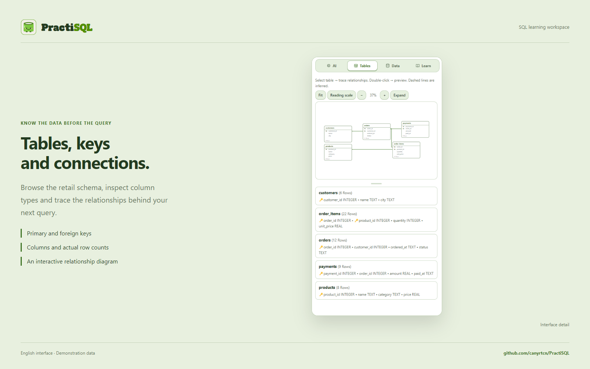

<p align="right"><a href="README.tr.md"></a></p>

# PractiSQL

### Learn SQL. Run it. See the result.

A desktop SQL learning workspace that brings local SQLite, an AI tutor, visual schemas and hands-on practice together.

<a href="https://github.com/canyrtcn/PractiSQL/releases"></a>

**Windows x64 · v3.4.261** &nbsp; | &nbsp; **macOS in preparation — no macOS download is available yet.**

The download button opens Releases. While the repository is private, access is limited to repository collaborators.


## One workspace for learning and doing

| Workspace | What you can do |
|---|---|
| **SQL** | Run SQLite on your device. Inspect results, query plans and table records. |
| **AI tutor** | Ask questions, discuss selected SQL or an explanation, and connect your own provider or an eligible ChatGPT account. |
| **Visual schema** | Explore tables, columns, keys and relationships in an interactive diagram. |
| **Lessons and practice** | Follow lessons, solve challenges, take exams and practise SQL expressions in 10-, 15- or 20-question rounds. |
| **Data projects** | Work with documented UCI data in separate workspaces, with numeric checks and feedback on your interpretation. |
| **Your learning space** | Conversations, PDF study notes, XP, badges, a customizable mascot and three themes. |

The SQL editor and built-in learning content work without an AI connection. English and Turkish interfaces, three workspace panes and 75–150% interface scaling are supported.


<details>
<summary><strong>See more of PractiSQL</strong></summary>




</details>

[84 screenshots](docs/en/screenshots.md) · [Presentation visuals](docs/assets/README.md)

The creator’s name and photo appear with explicit permission. Workspaces, conversations and retail records are demonstration data, not personal databases or conversations. Screens come from the actual application. Teaching and exam copy is prepared demonstration content; SQL results and local checks are executed in the app.

## AI harness

PractiSQL has an AI harness around the conversation. It coordinates request scope, model context, tool calls, local SQL execution and the record of what actually happened. The model chooses an SQL approach; the application supplies relevant schema and history, separates eligible SQL from teaching text, and preserves real results with their source.


Read-only tools can inspect current records and retrieve saved context. Reads run in a worker; normal automatic write batches use applicable integrity checks. Cancellation and late responses are tracked against their original workspace. These controls do not guarantee every model explanation is correct.

[Architecture and source map](docs/en/architecture.md) · [Architecture explorer — open locally](docs/architecture/index.html?lang=en)

## Bring your preferred AI connection

**ChatGPT account:** Open Settings → Provider → ChatGPT Account → Sign in with ChatGPT. Follow the supported account sign-in flow; this route does not require pasting a separate API key. Model availability, plan eligibility and usage limits depend on your account.

**API providers:** OpenAI, Anthropic Claude, Google AI Studio, DeepSeek, OpenCode Zen & Go, xAI, Moonshot, Zhipu, Cohere, Mistral, Groq, OpenRouter, Together AI, Alibaba Qwen, Perplexity.

The custom-provider option supports compatible HTTP/HTTPS endpoints. You choose the provider and model; no shared paid key is shipped. Availability and charges are controlled by the provider.

## Recorded model checks

This small shared Turkish/English evaluation reports historical local observations. It is not a new benchmark of 3.4.261 or a claim about general model accuracy.

| Recorded model | SQL tasks on the supplied data | Responses without a material teaching issue |
|---|---:|---:|
| GPT-6 Luna | 6 / 6 | 8 / 8 |
| Muse Spark 1.3 Contributor | 6 / 6 | 8 / 8 |
| DeepSeek v4.1 Flash | 6 / 6 | 6 / 8 |

Broader checks also found errors in model explanations and some SQL tasks. Results from different evaluation sets are reported separately. [Scope, other models and methodology](docs/en/benchmarks.md).

## Development

Requires Node.js 22 or newer and npm.

```sh
npm ci
npm start
```

```sh
npm run test:db
npm run test:security
npm run test:security:integration
npm run test:ui
npm run test:docs
```

Build a Windows installer with `npm run dist:win:unsigned`. The signed release configuration additionally requires a valid certificate. The unpacked app stays in `release/win-unpacked/`; installers and update metadata stay in `release/`.

[CONTRIBUTING.md](CONTRIBUTING.md) · [PRIVACY.md](PRIVACY.md) · [SECURITY.md](SECURITY.md) · [Release and update instructions](docs/RELEASING.md)

## Windows security notice

The current Windows installer is unsigned. Commercial code-signing costs exceed this free project’s current budget, so a publisher certificate has not yet been obtained. Windows may display a SmartScreen warning because the app is not recognized or has no verified publisher identity.

Download only from this repository’s Releases, compare the published SHA-256, and scan the installer if you wish. If you have verified the official download and choose to proceed, Windows may offer **More info → Run anyway**. You do not need to disable your antivirus. An unrecognized-app notice alone is not a malware detection; the source and release files are available for inspection and scanning.

[Microsoft SmartScreen](https://learn.microsoft.com/en-us/windows/security/operating-system-security/virus-and-threat-protection/microsoft-defender-smartscreen/)

## License

PractiSQL-authored source is licensed under [MIT](LICENSE). Third-party components retain their own licenses.

The bundled Sign in with ChatGPT DevKit has separate noncommercial terms; do not treat the entire bundle as exclusively MIT. [LICENSE](vendor/CHATGPT-SDK-LICENSE.txt) · [Notices](vendor/CHATGPT-SDK-NOTICES.md) · [Local changes](vendor/PRACTISQL-SDK-CHANGES.md).
