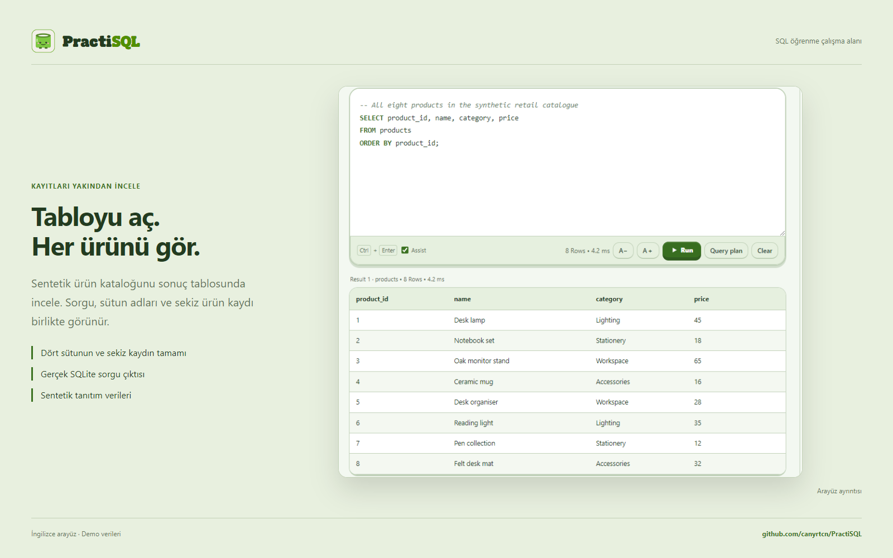

<p align="right"><a href="README.md"></a></p>

<h1></h1>

### SQL öğren. Çalıştır. Sonucu gör.

Yerel SQLite, AI öğretmen, görsel şema ve uygulamalı öğrenmeyi, bu akışları birlikte yöneten bir **AI harness** ile buluşturan masaüstü SQL çalışma alanı.

[Çalışma alanı](#kendi-çalışma-ortamını-oluştur) · [AI harness](#sohbetin-arkasındaki-ai-harness) · [Dersler](#bir-kavram-öğren-sonra-dene) · [AI bağlantısı](#tercih-ettiğin-ai-sağlayıcısını-bağla) · [Geliştirme](#geliştirme-ve-repo-düzeni)

<a href="https://github.com/canyrtcn/PractiSQL/releases"></a>

**Windows x64 · v3.4.262** · **macOS hazırlanıyor.**

Düğme Releases sayfasını açar. Repo gizliyken indirmeler için repo erişimi gerekir. Henüz indirilebilir bir macOS paketi yoktur.


**Sorgun, gerçek sonuçlar ve açıklama aynı yerde kalır.** Sol panel çalışma alanlarını ve sohbetleri düzenler; orta panel SQL’i ve sonuç tablolarını öne çıkarır; sağ panel öğretmeni, şemayı, veri araçlarını ve dersleri bir araya getirir. Hazır bir örnekle başlayabilir veya kendi yerel veritabanınla çalışabilirsin.

SQL cihazında çalışır. AI bağlantısı isteğe bağlıdır; editör, görsel şema ve hazır öğrenme içeriği bağlantı olmadan da kullanılabilir.

## Kendi çalışma ortamını oluştur


**Çalışma biçimini koruyarak Açık, Yaprak veya Koyu temayı seç.** SQL renklendirmesi, Markdown, sonuç tabloları ve öğrenme kontrolleri seçilen temaya uyar. Türkçe ve İngilizce arayüz, ayarlanabilir panel genişlikleri, arayüz yazı tipleri ve %75–150 ölçek seçimi aynı üç panelli alanı ekranına uyarlamanı sağlar.

Maskot, XP, rozetler ve öğrenme profili ilerlemeyi görünür kılar. Orta alan sorgu yazmaya ve tabloları incelemeye ayrılmıştır.

## İlk çalışma oturumun

1. **Bir örnek aç veya veritabanı yükle.** Hazır öğrenme alanları, hemen inceleyebileceğin tablolar ve kayıtlar sunar.
2. **Sorguyu çalıştır, satırları incele.** SQL'i değiştirirken editörü, gerçek sonuçları ve görsel şemayı birlikte kullan.
3. **İstediğinde öğretmeni bağla.** ChatGPT hesabı veya API sağlayıcısı ekle; sonuç hakkında soru sor ve açıklamayı gerçek tabloyla karşılaştır.

## Sohbetin arkasındaki AI harness


**Harness, sorudan gözlemlenen sonuca uzanan süreci koordine eder.** Her istek; çalışma alanını, sohbeti, veritabanı kimliğini, revizyonu ve seçilen arayüz işlemini taşır. Öğretmen yönergeleri, gerçek şema, ilgili geçmiş ve seçili metin, öğrencinin güncel sorusundan ayrı bir bağlam olarak birleştirilir.

Model, `read_context` ile önceki bir kaynağı geri getirebilir veya salt okuma aracı `inspect_database` ile yakalanmış veritabanını inceleyebilir. Seçilen modelin bağlam kapasitesi ve yanıt payı yönetilir. Eski içerik sıkıştırıldığında özgün mesajlar, SQL ve sonuç kaynakları daha sonra erişilmek üzere saklanır.

| Katman | PractiSQL’in yönettiği iş |
|---|---|
| **İstek yaşam döngüsü** | Kapsam, iptal, süre sınırları ve geç gelen yanıtın başka bir çalışma alanına veya veritabanı revizyonuna uygulanmasını önleme. |
| **Model ve araçlar** | Sağlayıcı protokolleri, hesap bağlantısı, araç çağrısı kimlikleri, salt okuma gözlemleri ve aynı isteğin devamı. |
| **SQL yürütmesi** | Çalıştırılacak SQL’i öğretim örneklerinden ayırma; okuma worker’ları, normal otomatik yazmalarda savepoint, SQLite kısıtları ve uygun veri koruma kontrolleri. |
| **Kanıt ve bellek** | Gerçek sonuç tabloları, tam SQL, hatalar, değişiklikler ve kaynak kimlikleri; sonraki sorular için tam sonuç arşivleri. |
| **Öğrenme akışları** | Kendi yürütme ve değerlendirme kurallarıyla dersler, challenge’lar, sınavlar, şemasız alıştırmalar ve veri projeleri. |

Uygun hatalarda özgün istek ve gerçek hata ya da işlem kanıtıyla tek, ortak ve koşullu bir düzeltme denemesi kullanılabilir. Okuma, otomatik yazma ve manuel işlemler ayrı yürütme sözleşmelerine sahiptir. Yerel kontroller tanımlı kapsamı denetler; öğretici açıklamalar ve iş yorumlarında model değerlendirmesi de yer alır.

[Mimariyi ve kaynak eşlemesini incele](docs/tr/architecture.md) · [Sekiz görünümde 48 bileşen](docs/architecture/index.html?lang=tr) — kaynakları indirdikten sonra HTML gezginini yerel olarak açabilirsin.

## SQL yaz, ne yaptığını incele


**Sorguyu sonuç satırlarına kadar takip et.** Bu örnekte ürünler, sipariş kalemleri ve siparişler birleştirilir; tamamlanan satışlar gruplanarak miktar ve gelir hesaplanır. Alttaki tablo, uygulamadaki gerçek SQLite yürütmesinin sonucudur.

Kendi SQL’ini yaz, sorgu planını incele, geçmiş sorgulara dön veya sohbet içindeki bir kod bloğunu editöre aktar. Kopyalama ve aktarma SQL metnini korur. Modelin açıklaması çalışmanın yanında durduğu için söylediklerini görünen sonuçla karşılaştırabilirsin.

## JOIN yazmadan önce tabloları anla


**İlişkilerin tamamını tek diyagramda gör.** Şema gezgini tabloları, gerçek sütun adlarını, birincil ve dış anahtarları, tanımlı ilişkileri ve satır sayılarını gösterir. Yakınlaştırma, kaydırma ve tablo seçimi bir bağlantıyı JOIN yazmadan önce takip etmene yardımcı olur. Yukarıdaki görsel beş demo tablosunun tamamını çerçeve içinde tutar.



**Tabloyu aç, kayıtlarını incele.** Burada sentetik ürün kataloğu gerçek sorgu sonucu olarak gösterilir; dört sütunun ve sekiz satırın tamamı görünür. Değerleri hem şemayla hem onları okuyan SQL ile karşılaştırabilirsin.

Yerel SQLite veritabanları ve dosya içe aktarımları öğrenme alanına dönüşebilir. Desteklenen sunucu içe aktarımları da yerel bir öğrenme kopyası oluşturur; bu kopya üzerinde sorgu çalıştırmak ayrı bir işlemdir.

## Bir kavram öğren, sonra dene


**Hazır dersler her SQL kavramı için bir başlangıç sunar.** Öğrenme yolunu takip et, açıklamayı oku, örnekleri incele ve ayrı bir ders çalışma alanında dene. Yol; seçim, filtreleme, sıralama, JOIN, gruplama ve daha ileri SQL konularını kapsar.

Challenge’lar bu kavramları şema ve örnek kayıtlar içeren görevlere dönüştürür. Cevaplar üç farklı deneme verisinde kontrol edilir. PDF çalışma notları ders içeriğini ve SQL gözlemlerini saklayabileceğin bir belgede, PractiSQL logo yazısı ve maskotuyla bir araya getirir.

## SQL’in yapısını çalış


**Sorguyu oku, eksik ifadeyi tamamla.** 10, 15 veya 20 soru ve zorluk seviyesi seç. Seçtiğin AI sağlayıcısı sentetik sorguları hazırlar; arayüz bir SQL ifadesini boşluğa dönüştürür, sorgunun dil bilgisini doğrular ve anahtar kelime cevabını yerel olarak inceler.

Bu alıştırma bir ifadenin veya fonksiyonun nerede kullanılacağını tanımaya odaklanır. Kişisel şemanı veya tablo kayıtlarını soru üreticisine göndermez. Tur bittiğinde cevapları ve açıklamaları görebilirsin.

## Bilgini sına ve geri dönüp incele


**Sınavlar soruyu, SQL kanıtını ve incelemeyi birleştirir.** Şema gezgini sınavın sabit veritabanı kopyasını kullanır. Soruyu oku, eksik SQL’i tamamla veya seçilen soru türünü yanıtla; ardından sonucu ve geri bildirimi incele. Öğrenci SQL’i veritabanı kopyasında kontrol edilir ve notlandırmada AI değerlendirmesi de kullanılır.

Boşluk doldurma sorusunda doğru, isteğe bağlı tam sorgu cevabı ek 25 XP kazandırır. Kayıtlı sınav geçmişi ve çalışma defterleri eski çalışmana dönmeyi sağlar; ödül takibi aynı soru setinden tekrar ödül alınmasını önler.

## Gerçek veriden işe yarayan bir rapora


**Belgelenmiş bir kaynaktan iş sorusuna ilerle.** Proje akışı resmî UCI kataloğunu tarayabilir, kaynağı inceleyebilir ve ölçülebilir bir görevi netleştirebilir. Kaynak ayrı bir çalışma alanına aktarılır; SQL’ini ve yorumunu burada teslim edersin.

Beklenen sayısal sonuçlar, özgün CSV kayıtlarından ve ölçüm tanımından bağımsız olarak hesaplanır. Ardından AI, eldeki kanıtlarla iş yorumunu değerlendirir. Proje bağlamı, teslimler, kontroller ve geri bildirim birbirine bağlı kalır; sonraki konuşma gerçekten değerlendirilen çalışmaya başvurabilir.

## Tercih ettiğin AI sağlayıcısını bağla

**ChatGPT hesabı:** Ayarlar → Sağlayıcı → ChatGPT Account → ChatGPT ile giriş yap. Hesap akışıyla oturum aç; bu yol için ayrıca API anahtarı yapıştırman gerekmez. Kullanılabilen modeller, plan uygunluğu ve kullanım limitleri hesabına bağlıdır.

**API sağlayıcıları:** OpenAI, Anthropic Claude, Google AI Studio, DeepSeek, OpenCode Zen & Go, xAI, Moonshot, Zhipu, Cohere, Mistral, Groq, OpenRouter, Together AI, Alibaba Qwen ve Perplexity.

Uyumlu özel HTTP/HTTPS uç noktaları da desteklenir. Sağlayıcını ve modelini sen seçersin; uygulamayla ortak bir ücretli anahtar dağıtılmaz. AI’a sorun, ilgili konuşma, şema ve gerekli gözlem veya sonuç satırları gönderilebilir. İlk kurulum bu paylaşımı bağlantıdan önce açıklar. [Gizlilik ayrıntıları](docs/PRIVACY.md).

### Önerilen modeller

PractiSQL içinde şu anda önerilen modeller bunlar. Sağlayıcının model listesinde hesabına açık olan seçeneği kullanabilirsin.

| Model | Sağlayıcı |
|---|---|
| **GPT-6 Luna** |  OpenAI |
| **Muse Spark 1.3** |  Meta |
| **DeepSeek V4.1 Flash** |  DeepSeek |

Model adları ve erişim sağlayıcıya ve hesaba göre değişebilir. [Logo kaynakları ve atıflar](docs/assets/providers/README.md).

## Daha fazla ekran ve belge

[84 uygulama ekranını incele](docs/tr/screenshots.md) · [Türkçe ve İngilizce sunum görselleri](docs/assets/README.md) · [Mimari](docs/tr/architecture.md)

Geliştiricinin adı ve fotoğrafı izniyle kullanılır. Tanıtım çalışma alanları, sohbetler, perakende kayıtları ve öğrenme istatistikleri sentetiktir. Ekranlar gerçek uygulamadan alınır; öğretim ve sınav metinleri hazırlanmış demo içeriğidir. SQL sonuçları ve yerel kontroller uygulamada çalıştırılmıştır.

## Geliştirme ve repo düzeni

Node.js 22 veya üzerini ve npm kullan.

```sh
npm ci
npm start
```

```sh
npm run test:db
npm run test:security
npm run test:security:integration
npm run test:ui
npm run test:layout
npm run test:docs
```

```text
app/       Electron uygulaması, arayüz, SQLite worker’ları ve öğrenme modülleri
config/    İmzalı yayın için build yapılandırması
docs/      İki dilde mimari, ekran görüntüleri ve sunum görselleri
scripts/   Taşınabilir doğrulama ve görsel üretim araçları
.github/   CI, katkı/güvenlik belgeleri ve hata şablonları
```

Kaynak modülleri `app/` altında toplanır; paketleme bunları mevcut çalışma yollarına yerleştirir. `npm ci`, yerel SQLite worker dosyalarını otomatik hazırlar. İmzasız Windows kurucusu için `npm run dist:win:unsigned` kullan; imzalı build ayrıca geçerli yayıncı kimliği gerektirir. Güncel çıktı `release/win-unpacked/`, kurucu ve güncelleme dosyaları doğrudan `release/` altında kalır.

Otomatik denetim açıkken yeni sürüm, üst bildirim alanında indirme ilerlemesi ve **Şimdi güncelle** düğmesiyle görünür. Kurulum yeniden başlatma onayı ister; ertelenen güncelleme uygulamayı kapatınca kurulmaz. Depo gizliyken anonim GitHub güncelleme akışına erişilemez.

[Katkı](.github/CONTRIBUTING.md) · [Güvenlik ve bilinen sınırlar](.github/SECURITY.md) · [Sürüm ve güncellemeler](docs/RELEASING.md)

## Windows güvenlik uyarısı

Mevcut kurucu imzasızdır. Ticari kod imzalama maliyeti bu ücretsiz projenin mevcut bütçesini aştığı için henüz yayıncı sertifikası alınmadı. Windows, uygulamanın tanınmaması veya doğrulanmış yayıncı kimliği bulunmaması nedeniyle SmartScreen uyarısı gösterebilir.

Kurucuyu bu reponun Releases sayfasından al, yayımlanan SHA-256 değeriyle karşılaştır ve istersen antivirüsünle tara. Resmî indirmeyi doğrulayıp çalıştırmaya karar verirsen Windows **Ek bilgi → Yine de çalıştır** yolunu sunabilir. Antivirüsü kapatman gerekmez. Tanınmama uyarısı tek başına zararlı yazılım tespiti değildir; kaynaklar ve dağıtım dosyaları incelemeye ve taramaya açıktır. [Microsoft SmartScreen](https://learn.microsoft.com/en-us/windows/security/operating-system-security/virus-and-threat-protection/microsoft-defender-smartscreen/).

## Lisans

PractiSQL’e ait kaynak kodu [MIT](LICENSE) kapsamındadır. Üçüncü taraf bileşenler kendi lisanslarını korur. Birlikte dağıtılan Sign in with ChatGPT DevKit’in ayrı ticari olmayan kullanım koşulları vardır; tüm paket yalnız MIT olarak değerlendirilmemelidir. [SDK lisansı](app/vendor/CHATGPT-SDK-LICENSE.txt) · [Bildirimler](app/vendor/CHATGPT-SDK-NOTICES.md) · [Yerel uyarlamalar](app/vendor/PRACTISQL-SDK-CHANGES.md).
