<p align="right"><a href="README.md"></a></p>

<p align="center"><picture><source media="(prefers-color-scheme: dark)" srcset="docs/assets/repository-wordmark-dark.svg"></picture></p>

<h3 align="center">SQL öğren. Çalıştır. Mantığını anla.</h3>

Yerel SQLite, AI öğretmen, görsel şema ve uygulamalı öğrenmeyi, bu akışları birlikte yöneten bir **AI harness** ile buluşturan masaüstü SQL çalışma alanı.

[AI öğretmene sor](#soru-sorarak-sql-öğren) · [Alıştırmalar](#sqlin-yapısını-çalış) · [PDF defterleri](#kapsamlı-çalışma-defterini-yanında-götür) · [AI harness](#sohbetin-arkasındaki-ai-harness) · [Başlarken](#başlarken)

<a href="https://github.com/canyrtcn/PractiSQL/releases"></a>

**Windows x64 · v3.4.262 · Sürüm hazırlığı** · **macOS hazırlanıyor.**

Düğme Releases sayfasını açar. Sürüm hazırlanıyor; henüz kurulum dosyası eklenmedi. Proje gizliyken repo erişimi gerekir.

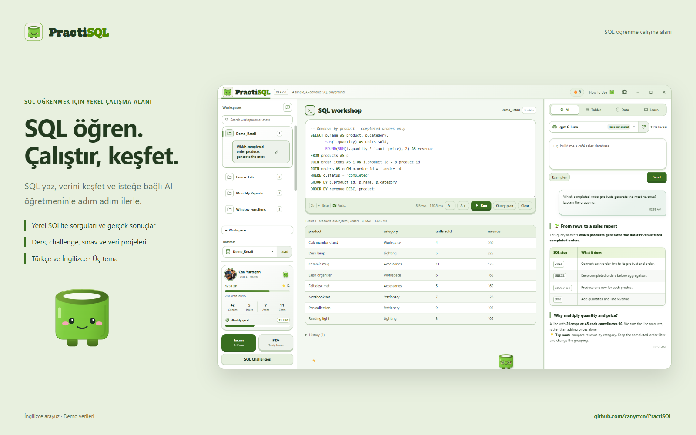

**Sorgun, gerçek sonuçlar ve açıklama aynı yerde kalır.** Sol panel çalışma alanlarını ve sohbetleri düzenler; orta panel SQL’i ve sonuç tablolarını öne çıkarır; sağ panel öğretmeni, şemayı, veri araçlarını ve dersleri bir araya getirir. Hazır bir örnekle başlayabilir veya kendi yerel veritabanınla çalışabilirsin.

**AI olmadan da SQL playground olarak kullan.** SQLite veritabanı, SQL dosyası veya CSV yükleyip kendi sorgularını yazabilir ve gerçek sonuçları inceleyebilirsin. Editör, şema görünümü ve yerel tamamlama AI bağlantısı gerektirmez. Açıklama veya sorgu üretimi istediğinde öğretmeni bağlayabilirsin.

## Soru sorarak SQL öğren

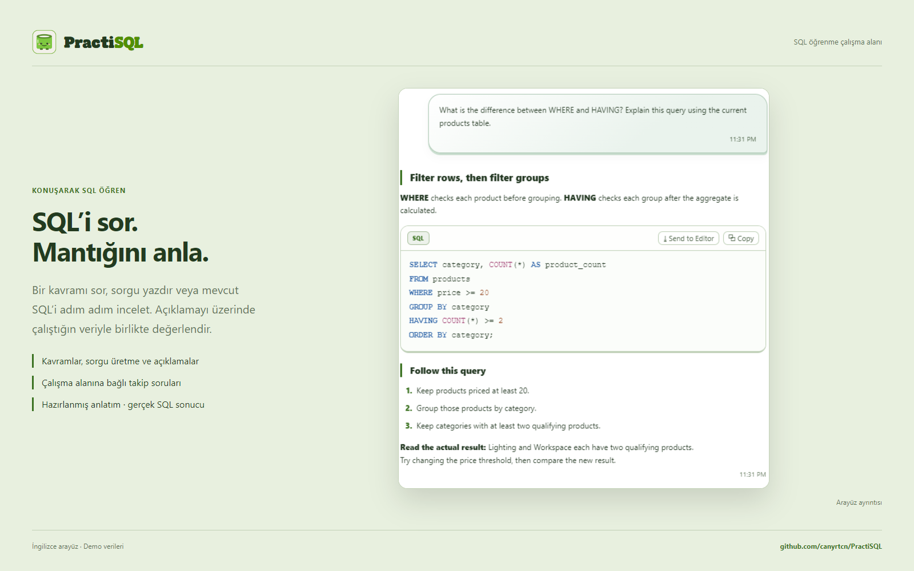

**Bir kavramı, elindeki sorguyu veya gördüğün sonucu sor.** PractiSQL’den bir JOIN’i açıklamasını, mevcut şemana uygun sorgu yazmasını, hazır SQL’i adım adım anlatmasını ya da bir sonucun neden değiştiğini açıklamasını isteyebilirsin. Takip soruları çalışma alanı ve sohbetle bağlantılı kalır. SQL seçebilir veya cevabın belirli bir bölümünü alıntılayarak sonraki soruyu daraltabilirsin.

| Ne öğrenmek istiyorsun? | Sorabileceğin bir soru |
|---|---|
| Bir kavramı anlamak | “WHERE ne zaman kullanılır, ne zaman HAVING gerekir?” |
| Bir fikri SQL’e çevirmek | “Mevcut tablolarımla tamamlanan satışları kategoriye göre getir.” |
| Hazır sorguyu okumak | “Bu SQL’i bölüm bölüm açıkla. Yalnız açıkla, çalıştırma.” |
| Görünen sonucu anlamak | “Bu JOIN neden daha fazla satır üretti?” |
| Konu çalışmak | “Gruplama için üç alıştırma ver. Çözümleri daha sonra isteyeceğim.” |

AI harness; ilgili şemayı, konuşmayı ve gözlemleri modele taşır, ardından gerçekten çalıştırılan işlemleri kaydeder. Görseldeki öğretici metin hazırlanmış demo içeriğidir; gösterilen sorgu ve sonuç yerelde çalıştırılmıştır.

## İlk çalışma oturumun

1. **Bir örnek aç veya veritabanı yükle.** Hazır öğrenme alanları, hemen inceleyebileceğin tablolar ve kayıtlar sunar.
2. **Sorguyu çalıştır, satırları incele.** SQL'i değiştirirken editörü, gerçek sonuçları ve görsel şemayı birlikte kullan.
3. **İstediğinde öğretmeni bağla.** ChatGPT hesabı veya API sağlayıcısı ekle; sonuç hakkında soru sor ve açıklamayı gerçek tabloyla karşılaştır.

## SQL yaz, ne yaptığını incele

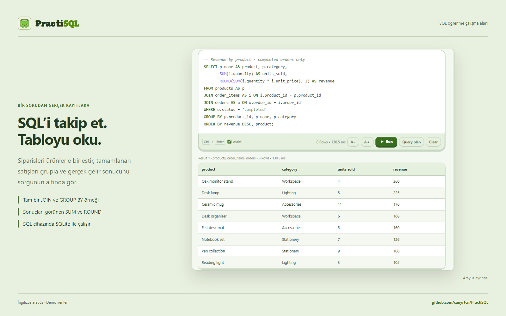

**Sorguyu sonuç satırlarına kadar takip et.** Bu örnekte ürünler, sipariş kalemleri ve siparişler birleştirilir; tamamlanan satışlar gruplanarak miktar ve gelir hesaplanır. Alttaki tablo, uygulamadaki gerçek SQLite yürütmesinin sonucudur.

Kendi SQL’ini yaz, sorgu planını incele, geçmiş sorgulara dön veya sohbet içindeki bir kod bloğunu editöre aktar. Kopyalama ve aktarma SQL metnini korur. Modelin açıklaması çalışmanın yanında durduğu için söylediklerini görünen sonuçla karşılaştırabilirsin.

## Yerel SQL tamamlama ile yazmaya devam et

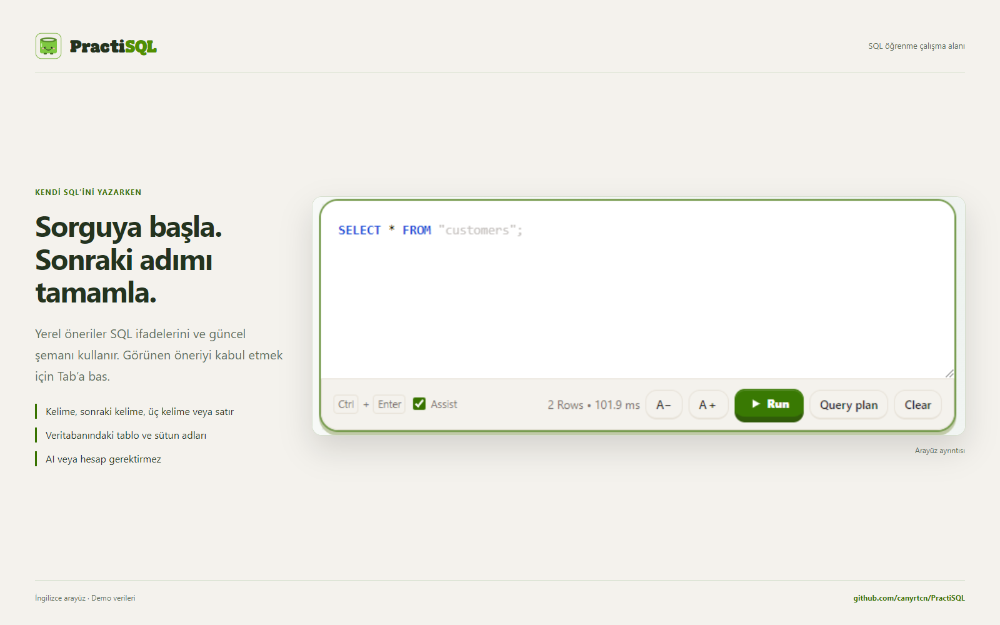

**Mevcut şemanı izleyen öneriyi Tab ile kabul et.** Kelime, sıradaki kelime, sonraki üç kelime veya satırın kalanı için tamamlama seçebilirsin. Öneriler yerel SQL sözlüğünü, tablo ve sütun adlarını kullanır. Editörün bu yardımı AI hesabı veya model çağrısı gerektirmez; öğretmenden sorgu yazmasını istemek ayrı bir özelliktir.

## Bir kavram öğren, sonra dene

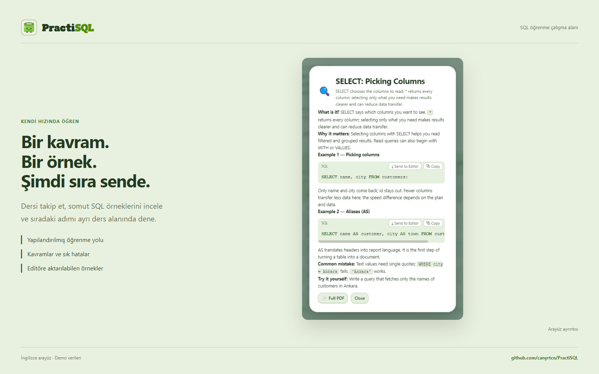

**Hazır dersler her SQL kavramı için bir başlangıç sunar.** Öğrenme yolunu takip et, açıklamayı oku, örnekleri incele ve ayrı bir ders çalışma alanında dene. Yol; seçim, filtreleme, sıralama, JOIN, gruplama ve daha ileri SQL konularını kapsar.

## SQL’in yapısını çalış

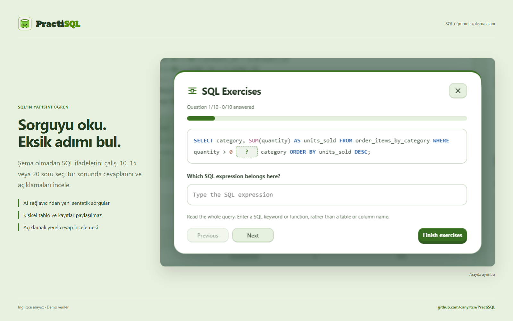

**Sorguyu oku, eksik ifadeyi tamamla.** 10, 15 veya 20 soru ve zorluk seviyesi seç. Seçtiğin AI sağlayıcısı sentetik sorguları hazırlar; arayüz bir SQL ifadesini boşluğa dönüştürür, sorgunun dil bilgisini doğrular ve anahtar kelime cevabını yerel olarak inceler.

Bu alıştırma bir ifadenin veya fonksiyonun nerede kullanılacağını tanımaya odaklanır. Kişisel şemanı veya tablo kayıtlarını soru üreticisine göndermez. Tur bittiğinde cevapları ve açıklamaları görebilirsin.

## Somut bir SQL göreviyle pratik yap

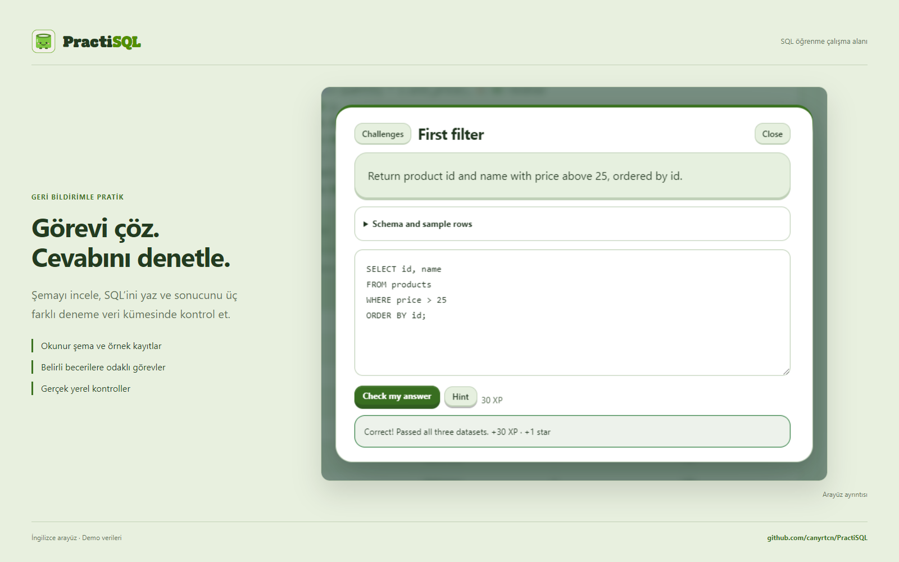

**Örneği okumaktan kendi sorgunu yazmaya ilerle.** Challenge’lar ayrı bir deneme veritabanında şema ve örnek kayıtlar sunar. Cevabın üç farklı deneme verisinde kontrol edilir; geri bildirime bakıp sorgunu geliştirebilirsin. Kişisel çalışma alanın challenge verisinden ayrı kalır.

## Bilgini sına ve geri dönüp incele

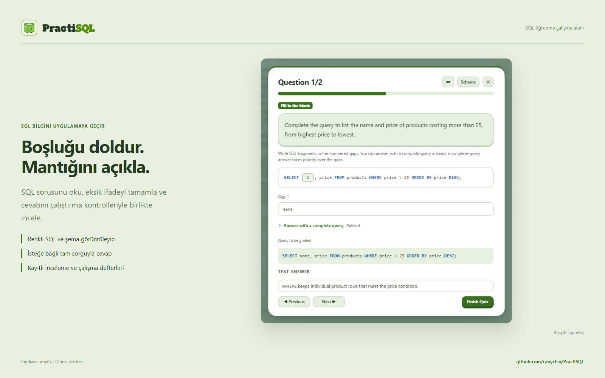

**Sınavlar soruyu, SQL kanıtını ve incelemeyi birleştirir.** Şema gezgini sınavın sabit veritabanı kopyasını kullanır. Soruyu oku, eksik SQL’i tamamla veya seçilen soru türünü yanıtla; ardından sonucu ve geri bildirimi incele. Öğrenci SQL’i veritabanı kopyasında kontrol edilir ve notlandırmada AI değerlendirmesi de kullanılır.

Boşluk doldurma sorusunda doğru, isteğe bağlı tam sorgu cevabı ek 25 XP kazandırır. Kayıtlı sınav geçmişi ve çalışma defterleri eski çalışmana dönmeyi sağlar; ödül takibi aynı soru setinden tekrar ödül alınmasını önler.

## Gerçek veriden işe yarayan bir rapora

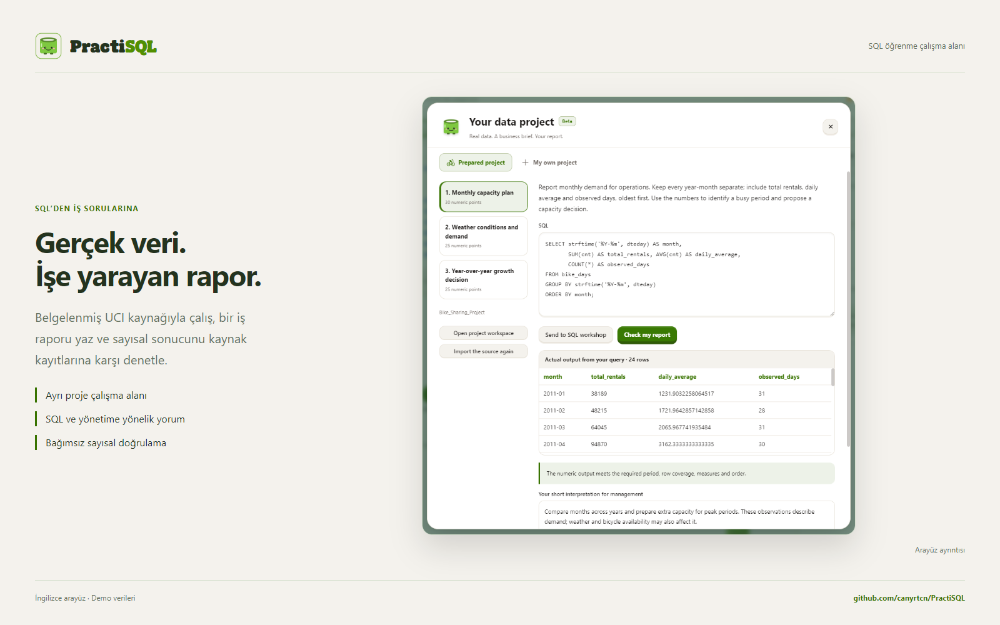

**Belgelenmiş bir kaynaktan iş sorusuna ilerle.** Proje akışı resmî UCI kataloğunu tarayabilir, kaynağı inceleyebilir ve ölçülebilir bir görevi netleştirebilir. Kaynak ayrı bir çalışma alanına aktarılır; SQL’ini ve yorumunu burada teslim edersin.

Beklenen sayısal sonuçlar, özgün CSV kayıtlarından ve ölçüm tanımından bağımsız olarak hesaplanır. Ardından AI, eldeki kanıtlarla iş yorumunu değerlendirir. Proje bağlamı, teslimler, kontroller ve geri bildirim birbirine bağlı kalır; sonraki konuşma gerçekten değerlendirilen çalışmaya başvurabilir.

## Kapsamlı çalışma defterini yanında götür

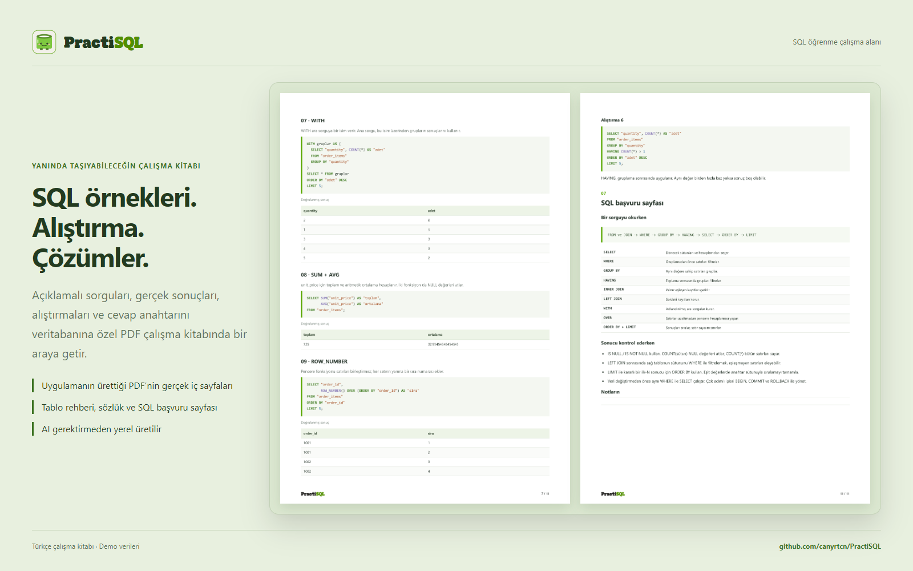

**Anlatımı, SQL’i ve alıştırmaları aynı belgede tut.** Oluşturulan defter; tablo rehberi, veri sözlüğü, tanımlı ilişkiler, gerçek sonuçlarıyla salt okuma sorguları, alıştırmalar, çözüm anahtarı ve SQL başvuru sayfasını içerir. Ders açıklamaları da PDF olarak dışa aktarılabilir. Görsel, uygulamada oluşturulan defterin örnek ve çözüm içeren gerçek iç sayfalarını gösterir.

Yerel çalışma defteri AI bağlantısı olmadan, mevcut veritabanından hazırlanır. Örnek sorgular defter oluşturulurken o veritabanında doğrulanır. PractiSQL logo yazısı ve maskotu belgede de yer alır; normal metin ve SQL okunaklı yazı tiplerini korur.

## JOIN yazmadan önce tabloları anla

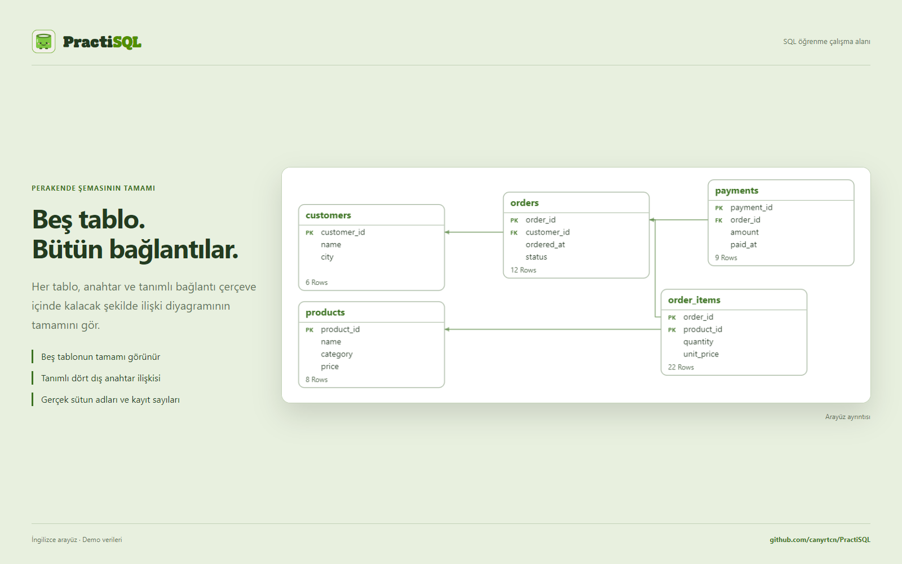

**İlişkilerin tamamını tek diyagramda gör.** Şema gezgini tabloları, gerçek sütun adlarını, birincil ve dış anahtarları, tanımlı ilişkileri ve satır sayılarını gösterir. Yakınlaştırma, kaydırma ve tablo seçimi bir bağlantıyı JOIN yazmadan önce takip etmene yardımcı olur. Yukarıdaki görsel beş demo tablosunun tamamını çerçeve içinde tutar.

Yerel SQLite veritabanları ve dosya içe aktarımları öğrenme alanına dönüşebilir. Desteklenen sunucu içe aktarımları da yerel bir öğrenme kopyası oluşturur; bu kopya üzerinde sorgu çalıştırmak ayrı bir işlemdir.

## Kendi çalışma ortamını oluştur

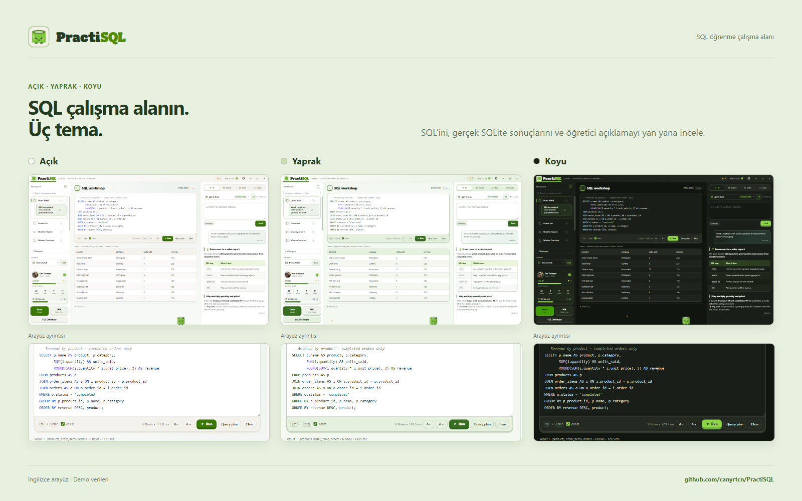

**Çalışma biçimini koruyarak Açık, Yaprak veya Koyu temayı seç.** SQL renklendirmesi, Markdown, sonuç tabloları ve öğrenme kontrolleri seçilen temaya uyar. Türkçe ve İngilizce arayüz, ayarlanabilir panel genişlikleri, arayüz yazı tipleri ve %75–150 ölçek seçimi aynı üç panelli alanı ekranına uyarlamanı sağlar.

Maskot, XP, rozetler ve öğrenme profili ilerlemeyi görünür kılar. Orta alan sorgu yazmaya ve tabloları incelemeye ayrılmıştır.

## Pratiği alışkanlığa dönüştür

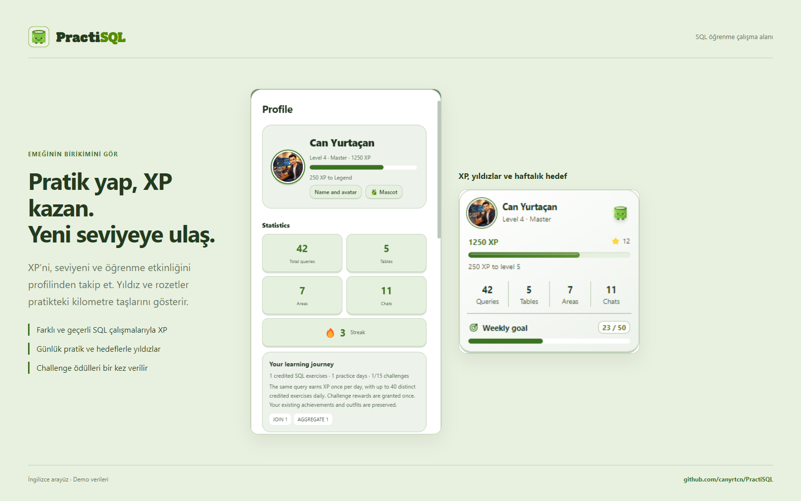

**Profilin ilerlemeni görünür kılar.** Farklı ve geçerli SQL çalışmaları, tamamlanan dersler ve öğrenme etkinlikleriyle XP kazan. Sıradaki seviyeyi, rozetlerini, pratik geçmişini ve haftalık hedefini takip et. Yıldızlar günlük pratiği ve tanımlı hedefleri ödüllendirir; aynı basit sorguyu tekrar etmek sınırsız XP kazandırmaz. Challenge ödülleri bir kez verilir.

Yukarıda tanıtılan hazır challenge’lar, belirli bir beceriye odaklanan görevleri ve cevabını deneyebileceğin üç farklı veri kümesini sunar. Yarım kalan görevine dön, geri bildirimi incele ve sonraki hedeflerin için pratik yap. Görsellerdeki profil değerleri sentetik demo ilerlemesidir.

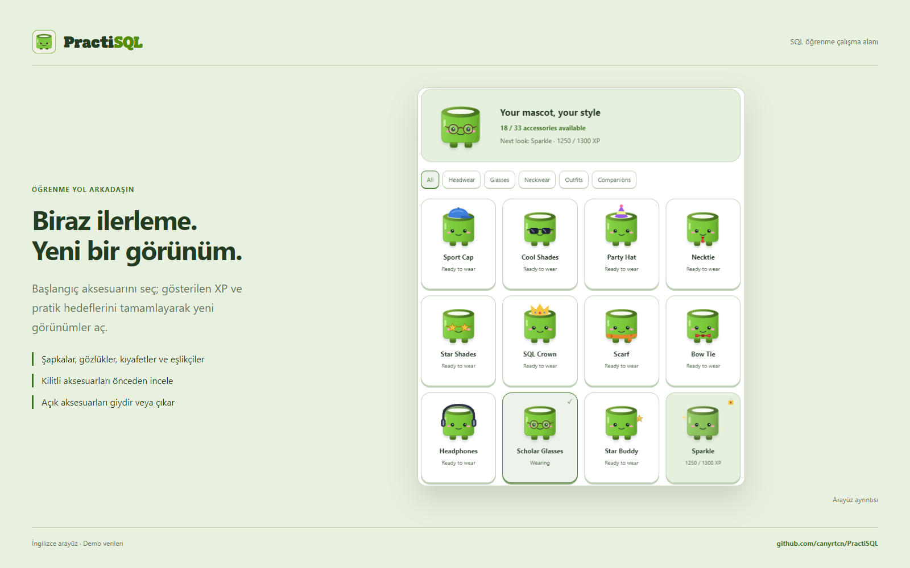

**Yol arkadaşının görünümünü seç.** Bazı aksesuarlar başlangıçtan itibaren açıktır. Diğerleri gösterilen XP ve gerekiyorsa pratik veya challenge hedefleri tamamlandığında açılır. Kilitli bir ürünü önizle, koşulunu gör; açık bir aksesuarı giydir veya çıkar. Şapkalar, gözlükler, boyun aksesuarları, kıyafetler ve eşlikçiler öğrenme yolculuğuna eşlik eder.

## Sohbetin arkasındaki AI harness

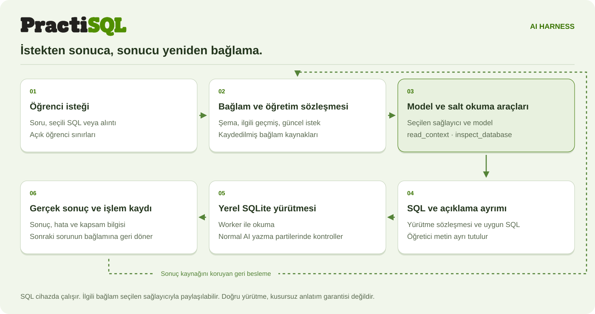

**Harness, sorudan gözlemlenen sonuca uzanan süreci koordine eder.** Her istek; çalışma alanını, sohbeti, veritabanı kimliğini, revizyonu ve seçilen arayüz işlemini taşır. Öğretmen kuralları, gerçek şema, ilgili geçmiş ve seçili metin, öğrencinin güncel sorusundan ayrı bir bağlam olarak birleştirilir.

Model, `read_context` ile önceki bir kaynağı geri getirebilir veya salt okuma aracı `inspect_database` ile yakalanmış veritabanını inceleyebilir. Seçilen modelin bağlam kapasitesi ve yanıt payı yönetilir. Eski içerik sıkıştırıldığında özgün mesajlar, SQL ve sonuç kaynakları daha sonra erişilmek üzere saklanır.

| Katman | PractiSQL’in yönettiği iş |
|---|---|
| **İstek yaşam döngüsü** | İstek kapsamı, iptal, süre sınırları ve geç gelen yanıtın başka bir çalışma alanına veya veritabanı revizyonuna uygulanmasını önleme. |
| **Model ve araçlar** | Sağlayıcı protokolleri, hesap bağlantısı, araç çağrısı kimlikleri, salt okuma gözlemleri ve aynı model isteğinin devamı. |
| **SQL yürütmesi** | Çalıştırılacak SQL’i öğretim örneklerinden ayırma; okuma worker’ları, normal AI yazmalarında SAVEPOINT, SQLite kısıtları ve ilgili veri koruma kontrolleri. |
| **Sonuçlar ve bellek** | Gerçek sonuç tabloları, tam SQL, hatalar, değişiklikler ve kaynak kimlikleri; sonraki sorular için tam sonuç arşivleri. |
| **Öğrenme akışları** | Kendi çalıştırma ve değerlendirme kurallarıyla dersler, challenge’lar, sınavlar, şemasız alıştırmalar ve veri projeleri. |

Uygun hatalarda özgün istek ve gerçek hata ya da işlem kanıtıyla tek, ortak ve koşullu bir düzeltme denemesi kullanılabilir. Okuma, otomatik yazma ve manuel işlemler ayrı yürütme sözleşmelerine sahiptir. Yerel kontroller tanımlı kapsamı denetler; öğretici açıklamalar ve iş yorumlarında model değerlendirmesi de yer alır.

[Mimariyi ve kaynak eşlemesini incele](docs/tr/architecture.md) · [Sekiz görünümde 48 bileşen](docs/architecture/index.html?lang=tr) — kaynakları indirdikten sonra HTML gezginini yerel olarak açabilirsin.

<details>
<summary>Bir isteğin tüm harness boyunca izlediği doğrusal akış</summary>

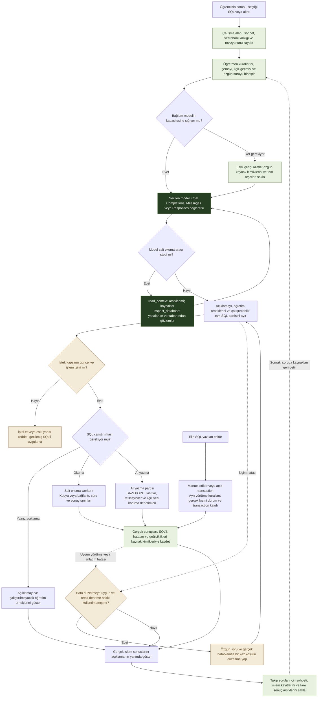

[Doğrusal akışı ve yürütme sınırlarını incele](docs/tr/request-flow.md).

</details>

## Tercih ettiğin AI sağlayıcısını bağla

**ChatGPT hesabı:** Ayarlar → Sağlayıcı → ChatGPT Account → ChatGPT ile giriş yap. Hesap akışıyla oturum aç; bu yol için ayrıca API anahtarı yapıştırman gerekmez. Kullanılabilen modeller, plan uygunluğu ve kullanım limitleri hesabına bağlıdır.

**API sağlayıcıları:** OpenAI, Anthropic Claude, Google AI Studio, DeepSeek, OpenCode Zen & Go, xAI, Moonshot, Zhipu, Cohere, Mistral, Groq, OpenRouter, Together AI, Alibaba Qwen ve Perplexity.

Uyumlu özel HTTP/HTTPS uç noktaları da desteklenir. Sağlayıcını ve modelini sen seçersin; uygulamayla ortak bir ücretli anahtar dağıtılmaz. AI’a sorun, ilgili konuşma, şema ve gerekli gözlem veya sonuç satırları gönderilebilir. İlk kurulum bu paylaşımı bağlantıdan önce açıklar. [Gizlilik ayrıntıları](docs/PRIVACY.md).

### Önerilen modeller

- **GPT-6 Luna**
- **Muse Spark 1.3**
- **DeepSeek V4.1 Flash**

Hesabında kullanılabilen model seçeneğini kullan. Model adları ve erişim değişebilir; bu liste bir öneridir, ölçülmüş bir kalite sıralaması değildir.

## Başlarken

1. [Releases](https://github.com/canyrtcn/PractiSQL/releases) sayfasını aç. Windows sürümü hazırlanıyor; henüz kurulum dosyası eklenmedi.
2. Kurucu yayımlandığında yükle ve ilk kurulumda dilini seç. macOS sürümü hazırlanıyor.
3. Desteklenen veritabanını veya dosyanı yükle ya da hazır bir öğrenme örneği aç. SQL yazmaya ve çalıştırmaya hemen başlayabilirsin.
4. Açıklama, sorgu üretimi veya AI destekli öğrenme akışları istediğinde AI bağlantısı ekle. Bu adımı sonraya bırakabilirsin.

[Sürüm notları ve hazırlık durumu](docs/releases/v3.4.262.md) · [Kaynaktan çalıştır](#geliştirme-ve-repo-düzeni)

## Daha fazla ekran ve belge

[90 uygulama ekranını incele](docs/tr/screenshots.md) · [Türkçe ve İngilizce sunum görselleri](docs/assets/README.md) · [Mimari](docs/tr/architecture.md)

Geliştiricinin adı ve fotoğrafı izniyle kullanılır. Tanıtım çalışma alanları, sohbetler, perakende kayıtları ve öğrenme istatistikleri sentetiktir. Ekranlar gerçek uygulamadan alınır; öğretim ve sınav metinleri hazırlanmış demo içeriğidir. SQL sonuçları ve yerel kontroller uygulamada çalıştırılmıştır.

## Sık sorulan sorular

**PractiSQL için AI şart mı?** Hayır. SQLite veritabanı, SQL dosyası veya CSV yükleyip AI bağlamadan SQL yazabilir, sorgu çalıştırabilir, sonuçları ve ilişkileri inceleyebilir, yerel tamamlamayı kullanabilirsin. Hazır dersler, challenge’lar ve yerel çalışma defteri de pratik sağlar. Modelden cevap alma, sınav, SQL ifadesi alıştırması üretimi ve projelerin AI bölümleri için AI bağlantısı gerekir.

**Sunucudan alınan veritabanı canlı sunucu çalışma alanı olarak mı kalır?** Desteklenen PostgreSQL, MySQL ve SQL Server içe aktarımları yerel bir SQLite öğrenme kopyası oluşturur. Bu kopyayı sorgulamak, asıl sunucuyu sorgulamaktan ayrı bir işlemdir.

**Sorgunun çalışması açıklamanın da doğru olduğunu kanıtlar mı?** Hayır. SQL’in çalışması, görevi doğru çözmesi ve açıklamanın doğruluğu ayrı konulardır. Gerçek sonucu ve anlatımı birlikte incele; uygulamanın kontrolleri tanımlı kapsamı denetler.

**Çalışmalarım nerede saklanır?** Veritabanları, sohbetler ve tercihler uygulama profilinde kalır; varsayılan olarak şifrelenmez. Kaydedilen bağlantı kimlik bilgileri işletim sistemi korumasını kullanır. AI özelliklerinde ilgili veriler seçtiğin AI bağlantısıyla paylaşılabilir. [Gizlilik](docs/PRIVACY.md).

## Geliştirme ve repo düzeni

Node.js 22 veya üzerini ve npm kullan.

```sh
npm ci
npm start
```

```sh
npm run test:db
npm run test:security
npm run test:security:integration
npm run test:ui
npm run test:layout
npm run test:docs
```

```text
app/       Electron uygulaması, arayüz, SQLite worker’ları ve öğrenme modülleri
config/    İmzalı yayın için build yapılandırması
docs/      İki dilde mimari, ekran görüntüleri ve sunum görselleri
scripts/   Taşınabilir doğrulama ve belge üretim araçları
.github/   CI, katkı/güvenlik belgeleri ve hata şablonları
```

Kaynak modülleri `app/` altında toplanır; paketleme bunları mevcut çalışma yollarına yerleştirir. `npm ci`, yerel SQLite worker dosyalarını otomatik hazırlar. İmzasız Windows kurucusu için `npm run dist:win:unsigned` kullan; imzalı build ayrıca geçerli yayıncı kimliği gerektirir. Güncel çıktı `release/win-unpacked/`, kurucu ve güncelleme dosyaları doğrudan `release/` altında kalır.

Otomatik denetim açıkken yeni sürüm, üst bildirim alanında indirme ilerlemesi ve **Şimdi güncelle** düğmesiyle görünür. Kurulum yeniden başlatma onayı ister; ertelenen güncelleme uygulamayı kapatınca kurulmaz. Depo gizliyken anonim GitHub güncelleme akışına erişilemez.

[Katkı](.github/CONTRIBUTING.md) · [Güvenlik ve bilinen sınırlar](.github/SECURITY.md) · [Sürüm ve güncellemeler](docs/RELEASING.md)

Üretilen sunum HTML’leri ve QA çıktıları Git dışında kalan `artifacts/` altında tutulur; kaynak ağacında galeri, mimari rehberi ve son görseller bulunur.

## Destek ve katkı

Tekrarlanabilen sorunları uygulama sürümü ve yeniden oluşturma adımlarıyla [Issues](https://github.com/canyrtcn/PractiSQL/issues) üzerinden bildir. Sentetik veri veya hassas alanları kaldırılmış örnek paylaş. Hassas bulgularda [güvenlik politikasını](.github/SECURITY.md) kullan; API anahtarı, hesap tokenı veya kişisel uygulama profili ekleme.

[Katkı](.github/CONTRIBUTING.md) · [Kaynak yayın politikası](docs/PUBLICATION.md) · [Mimari ve kod eşlemesi](docs/tr/architecture.md) · [Öğrenme akışları rehberi](docs/tr/learning-workflows.md)

## Windows güvenlik uyarısı

Mevcut kurucu imzasızdır. Ticari kod imzalama maliyeti bu ücretsiz projenin mevcut bütçesini aştığı için henüz yayıncı sertifikası alınmadı. Windows, uygulamanın tanınmaması veya doğrulanmış yayıncı kimliği bulunmaması nedeniyle SmartScreen uyarısı gösterebilir.

Kurucuyu bu reponun Releases sayfasından al, yayımlanan SHA-256 değeriyle karşılaştır ve istersen antivirüsünle tara. Resmî indirmeyi doğrulayıp çalıştırmaya karar verirsen Windows **Ek bilgi → Yine de çalıştır** yolunu sunabilir. Antivirüsü kapatman gerekmez. Tanınmama uyarısı tek başına zararlı yazılım tespiti değildir; kaynaklar ve dağıtım dosyaları incelemeye ve taramaya açıktır. [Microsoft SmartScreen](https://learn.microsoft.com/en-us/windows/security/operating-system-security/virus-and-threat-protection/microsoft-defender-smartscreen/).

## Lisans

PractiSQL’e ait kaynak kodu [MIT](LICENSE) kapsamındadır. Üçüncü taraf bileşenler kendi lisanslarını korur. Birlikte dağıtılan Sign in with ChatGPT DevKit’in ayrı ticari olmayan kullanım koşulları vardır; tüm paket yalnız MIT olarak değerlendirilmemelidir. [SDK lisansı](app/vendor/CHATGPT-SDK-LICENSE.txt) · [Bildirimler](app/vendor/CHATGPT-SDK-NOTICES.md) · [Yerel uyarlamalar](app/vendor/PRACTISQL-SDK-CHANGES.md).
