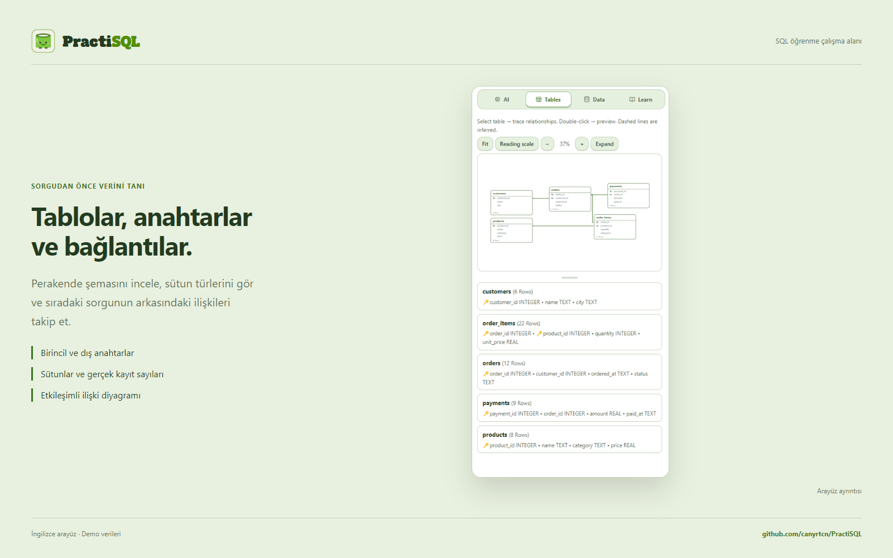

<p align="right"><a href="README.md"></a></p>

# PractiSQL

### SQL öğren. Çalıştır. Sonucu gör.

Yerel SQLite çalışma alanını AI öğretmen, görsel şema, dersler ve uygulamalı görevlerle birleştiren masaüstü uygulaması.

<a href="https://github.com/canyrtcn/PractiSQL/releases"></a>

**Windows x64 · v3.4.261** &nbsp; | &nbsp; **macOS hazırlanıyor — henüz indirilebilir bir macOS paketi yok.**

İndirme düğmesi Releases sayfasını açar. Repo gizliyken bu sayfayı yalnız erişimi olan kişiler görebilir.


## Bir çalışma alanında öğren ve uygula

| Alan | Yapabileceklerin |
|---|---|
| **SQL** | SQLite sorgularını cihazında çalıştır; sonuçları, sorgu planını ve tablo kayıtlarını incele. |
| **AI öğretmen** | Soru sor, seçili SQL’i veya bir açıklamayı tartış; kendi sağlayıcını ya da uygun ChatGPT hesabını bağla. |
| **Görsel şema** | Tabloları, sütunları, anahtarları ve ilişkileri etkileşimli diyagramda keşfet. |
| **Ders ve pratik** | Dersleri izle; challenge, sınav ve 10/15/20 soruluk şemasız SQL alıştırmalarıyla çalış. |
| **Veri projeleri** | Ayrı çalışma alanlarında gerçek UCI veri kaynaklarıyla çalış; sayısal sonuçları ve iş yorumunu değerlendir. |
| **Kişisel çalışma alanı** | Sohbetler, PDF çalışma notları, XP, rozetler, kıyafetli maskot ve üç tema. |

SQL editörü ve hazır öğrenme içeriği AI bağlantısı olmadan kullanılabilir. Türkçe ve İngilizce arayüz, üç panel ve %75–150 arayüz ölçeği desteklenir.


<details>
<summary><strong>Daha fazla ekran görüntüsü</strong></summary>




</details>

[84 ekran görüntüsü](docs/tr/screenshots.md) · [Sunum görselleri](docs/assets/README.md)

Görsellerde geliştiricinin adı ve fotoğrafı kendi açık izniyle kullanılır. Çalışma alanları, sohbetler ve perakende kayıtları örnektir; kişisel veritabanı veya konuşma içermez. Ekranlar gerçek uygulamadan alınır. Tanıtımdaki öğretim/sınav metinleri hazırlanmış örneklerdir; SQL sonuçları ve yerel denetimler uygulamada çalıştırılır.

## AI harness

PractiSQL’in AI harness sistemi; isteğin kapsamını, modele giden bağlamı, araç çağrılarını, yerel SQL yürütmesini ve gerçek işlem kaydını birlikte yönetir. Model SQL yaklaşımını seçer; uygulama ilgili şemayı ve geçmişi sağlar, yürütülebilir SQL’i öğretici açıklamadan ayırır ve gerçekleşen sonucu kaynağıyla saklar.


Salt okuma araçları güncel veriyi inceleyebilir ve kaydedilmiş bağlamı geri çağırabilir. Okumalar worker’da, normal otomatik yazma partileri uygun bütünlük kontrolleriyle çalışır. İptal ve eski çalışma alanına gelen geç yanıtlar ayrı izlenir. Bu kontroller modelin her açıklamasının doğru olduğunu garanti etmez.

[Mimari ve kaynak eşlemesi](docs/tr/architecture.md) · [Mimari gezgini — yerel olarak aç](docs/architecture/index.html?lang=tr)

## Kendi AI bağlantını seç

**ChatGPT hesabı:** Ayarlar → Sağlayıcı → ChatGPT Account → ChatGPT ile giriş yap. Desteklenen hesap akışıyla oturum aç; bu yol için ayrıca API anahtarı yapıştırman gerekmez. Kullanılabilen modeller, plan uygunluğu ve kullanım limitleri hesabına bağlıdır.

**API sağlayıcıları:** OpenAI, Anthropic Claude, Google AI Studio, DeepSeek, OpenCode Zen & Go, xAI, Moonshot, Zhipu, Cohere, Mistral, Groq, OpenRouter, Together AI, Alibaba Qwen, Perplexity.

Özel sağlayıcı seçeneği desteklenen uyumlu HTTP/HTTPS uç noktalarını da bağlar. Sağlayıcını ve modelini sen seçersin; uygulamayla ortak bir ücretli anahtar dağıtılmaz. Erişim ve fiyatlar sağlayıcıya aittir.

## Kaydedilmiş model kontrolleri

Aşağıdaki küçük ortak TR/EN değerlendirmesi, tarihsel yerel test sonuçlarını gösterir; 3.4.261 için yeni bir benchmark veya genel model doğruluğu iddiası değildir.

| Model | Güncel veri üzerinde SQL görevi | Önemli anlatım kusuru saptanmayan yanıt |
|---|---:|---:|
| GPT-6 Luna | 6 / 6 | 8 / 8 |
| Muse Spark 1.3 Contributor | 6 / 6 | 8 / 8 |
| DeepSeek v4.1 Flash | 6 / 6 | 6 / 8 |

Daha geniş testlerde model açıklamalarında ve bazı SQL görevlerinde hatalar da gözlendi. Farklı değerlendirme setlerinin sonuçları ayrı gösterilir. [Kapsam, diğer modeller ve yöntem](docs/tr/benchmarks.md).

## Geliştirme

Node.js 22 veya üzeri ve npm gerekir.

```sh
npm ci
npm start
```

```sh
npm run test:db
npm run test:security
npm run test:security:integration
npm run test:ui
npm run test:docs
```

Windows kurucusu: `npm run dist:win:unsigned`. İmzalı yayın yapılandırması ayrıca geçerli sertifika gerektirir. Güncel çıktı düzeni `release/win-unpacked/`, kurucu ve güncelleme dosyaları için `release/` olarak korunur.

[CONTRIBUTING.md](CONTRIBUTING.md) · [PRIVACY.md](PRIVACY.md) · [SECURITY.md](SECURITY.md) · [Sürüm ve güncelleme yayını](docs/RELEASING.md)

## Windows güvenlik uyarısı

Mevcut Windows kurucusu imzasızdır. Ticari kod imzalamanın maliyeti bu ücretsiz projenin mevcut bütçesini aştığı için henüz yayıncı sertifikası alınmadı. Windows, uygulamanın tanınmaması veya doğrulanmış yayıncı kimliğinin olmaması nedeniyle SmartScreen uyarısı gösterebilir.

Kurucuyu yalnız bu reponun Releases sayfasından al, yayımlanan SHA-256 değeriyle karşılaştır ve istersen antivirüsünle tara. Resmî indirmeyi doğrulayıp çalıştırmaya karar verirsen, Windows izin verdiğinde **Ek bilgi → Yine de çalıştır** yolunu kullanabilirsin. Antivirüsü kapatman gerekmez. Bir tanınmama uyarısı tek başına zararlı yazılım tespiti değildir; kaynak kodu ve dağıtım dosyaları incelemeye ve taramaya açıktır.

[Microsoft SmartScreen](https://learn.microsoft.com/en-us/windows/security/operating-system-security/virus-and-threat-protection/microsoft-defender-smartscreen/)

## Lisans

PractiSQL’e ait kaynak kodu [MIT](LICENSE). Üçüncü taraf bileşenler kendi lisanslarını korur.

Birlikte dağıtılan Sign in with ChatGPT DevKit’in ayrı, ticari olmayan kullanım koşulları vardır; tüm paketi yalnız MIT olarak değerlendirme. [LICENSE](vendor/CHATGPT-SDK-LICENSE.txt) · [Notices](vendor/CHATGPT-SDK-NOTICES.md) · [Local changes](vendor/PRACTISQL-SDK-CHANGES.md).
