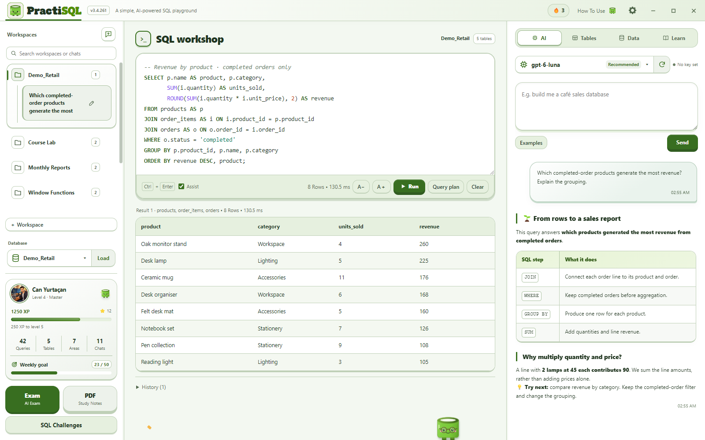
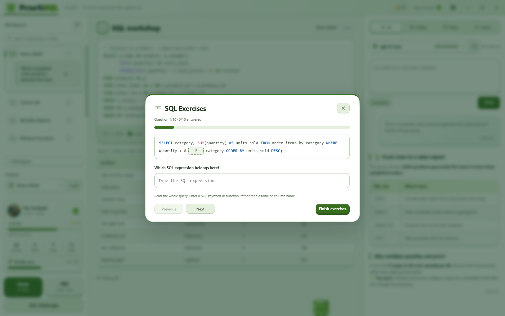
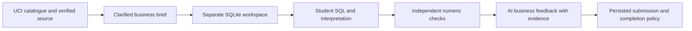
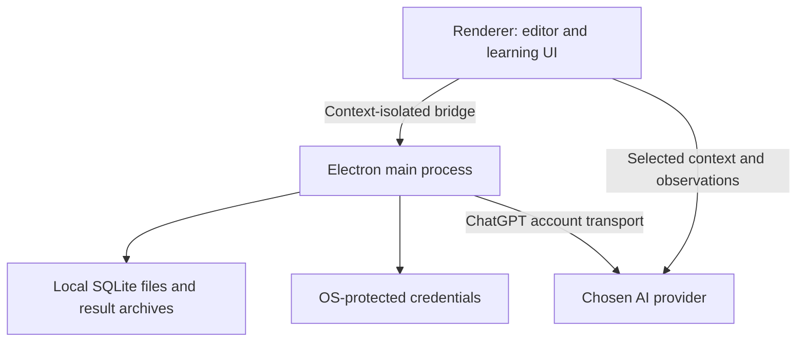

# How PractiSQL works

PractiSQL is a local SQLite learning workspace with an optional AI tutor. Its AI harness coordinates request context, model tools, SQL execution, evidence and learning workflows. The model interprets the question and chooses an SQL approach; the application supplies context, executes eligible SQL, and records what actually happened.

[Türkçe](../tr/architecture.md) · [Interactive architecture presentation](../architecture/index.html?lang=en) · [Source diagram](../architecture/ai-harness.en.svg)

The SQL editor uses an incremental CodeMirror document. Local workers handle SQL syntax parsing and completion analysis; only the visible code ranges receive rendered highlight spans. Editing a large script therefore does not rebuild the whole highlighted document on each keystroke. Suggestions use cached schema definitions, columns, aliases and declared foreign keys, without querying table records. Highlighting, completion, selection and copying remain available for large scripts. These presentation workers do not execute SQL or alter the execution paths described below.

The diagram connects three layers: source-backed context and memory, model and tool orchestration, and local SQLite execution with actual operation records. The learning workflows below share this foundation with their own data and evaluation rules. Green arrows show request/execution flow, dashed lines show source retrieval and feedback, and amber lines show the single conditional repair path.

This demonstration uses synthetic retail data. The SQL editor and result table show local execution; the teaching message illustrates how the conversation can explain those results. The [screenshot gallery](screenshots.md) covers all 30 sections in three themes.

## The request lifecycle

**Read the numbered path from top to bottom.** The side branches retain conditional context compaction, request-scoped read-only tools, stale-request rejection, separate read/AI-write/manual execution and the single shared repair budget. Actual result archives return as sources for later questions. The separate manual-editor entry does not pass through a model.

1. Capture the active workspace, conversation, database revision and explicit UI action.
2. Assemble the teacher contract, actual SQLite schema, relevant history, observations and selected text. Preserve the current question.
3. Use the chosen provider. The model can retrieve saved context with `read_context` or inspect current records with `inspect_database`; these are read-only observations.
4. Distinguish runnable SQL from examples and explanation. The execution contract controls which batch is eligible to run.
5. Execute reads on a copied connection in a worker. Normal automatic write batches use a savepoint and applicable integrity checks. Explicit connection/transaction commands and manual editor execution have their own paths.
6. Record actual results, failures, partial states and provenance in the conversation. Historical results come from their saved source rather than silently rerunning the query on newer data.

A repair is conditional and bounded. A successful response is not routinely sent to a second model. A local execution or constraint check does not prove that every natural-language interpretation or teaching claim is correct.

## Responsibilities and code

| Responsibility | Main source |
|---|---|
| Workspace and request orchestration | [renderer/app.js](../../app/renderer/app.js), [request envelope](../../app/renderer/ai-request-envelope.js) |
| Teacher and response contracts | [teacher contract](../../app/renderer/ai-teacher-contract.js), [answer envelope](../../app/renderer/ai-answer-envelope.js), [code fences](../../app/renderer/response-fences.js) |
| Context capacity and saved sources | [context manager](../../app/renderer/ai-context-manager.js), [context sources](../../app/renderer/ai-context-sources.js) |
| Native database observations | [database inspection](../../app/database-inspection), [tool protocol](../../app/renderer/ai-tool-protocol.js) |
| SQLite reads and evidence | [read runner](../../app/sql-read-runner.cjs), [write evidence](../../app/sql-write-evidence.cjs), [seed observations](../../app/sql-seed-evidence.cjs) |
| Persistence | [database store](../../app/database-store.cjs), [result archive](../../app/operation-result-store.cjs), [conversation records](../../app/renderer/ai-conversation.js) |
| Account/provider transport | [main process](../../app/main.js), [ChatGPT bridge](../../app/chatgpt-account.js), [local SDK changes](../../app/vendor/PRACTISQL-SDK-CHANGES.md) |

## Context and cancellation

Context follows the selected provider's capacity. Compaction retains saved source material so `read_context` can retrieve details when needed. Current database observations and historical results have different identities and are not interchangeable.

Late responses are checked against the original workspace, conversation and database revision. Cancellation stops outstanding provider and tool work; an operation already committed is not relabelled as cancelled. These controls preserve lifecycle boundaries, not model accuracy.

## Learning workflows

| Workflow | Data and evaluation |
|---|---|
| Manual editor | Local SQL execution, independent of AI. |
| Lessons and PDF notes | Built-in teaching fixtures and local observations; generated lesson SQL is not automatically applied to a personal workspace. |
| Challenges | A separate practice database; answers are checked against three fixture variants. |
| Exams | Separate generation/grading lifecycle, captured connection settings and disposable answer execution. |
| SQL exercises | AI generates complete synthetic queries. The interface removes a selected SQL expression, checks grammar in an empty disposable SQLite connection and reviews keyword answers locally. No personal schema or records enter exercise requests. |
| Data projects | Verified UCI source, project brief, independent workspace, numeric checks and evidence-based AI business feedback. |

The exam schema viewer uses the same frozen database snapshot as the exam. Each correct optional complete-query answer to a fill-in question earns an additional 25 XP; the existing question-set reward ledger prevents duplicate rewards. Exercises offer 10, 15 or 20 questions and do not execute the learner’s answers against a database.

Project reports are evaluated from the source records using their declared measurements, rather than treating AI-generated reference SQL as the answer key. AI feedback on business meaning remains a separate judgment. Completion and one-time rewards belong to application code.

## Trust and privacy boundaries

- SQL runs locally. AI can receive the question, relevant conversation, schema and sample/result observations. The first-run provider step explains this before connection selection.
- Provider keys use Electron safeStorage; Windows uses DPAPI. Legacy plaintext keys migrate atomically. This does not isolate secrets from all malicious software running as the same OS user.
- The renderer CSP restricts executable scripts and permits packaged WASM/workers. Custom HTTP/HTTPS provider endpoints and existing styling remain supported; this is not a complete network sandbox.
- Signed public builds require a genuine signing identity and publisher verification. Unsigned local builds preserve development behavior. There is currently no trusted publisher certificate.
- Databases and conversations are not encrypted by default. Supported-runtime upgrades and other known limitations are listed in [SECURITY.md](../../.github/SECURITY.md).

## Reading the presentation

Download the repository and open `docs/architecture/index.html` in a browser. It works offline and lets readers select English or Turkish, eight views, and individual components. The language switch preserves the current view and selected component. GitHub renders the Markdown/Mermaid diagrams directly; the HTML source does not require enabling Pages or a hosted service.

The [structured architecture data](../architecture/architecture.json) records component/source relationships. Rebuild the standalone HTML and both language-specific SVG diagrams with `npm run docs:build`. Run `npm run test:docs` to check translations, navigation, responsive layout and local links in a hidden Electron session. Recheck the narrative when execution contracts change; generated graphics alone do not establish correctness.
