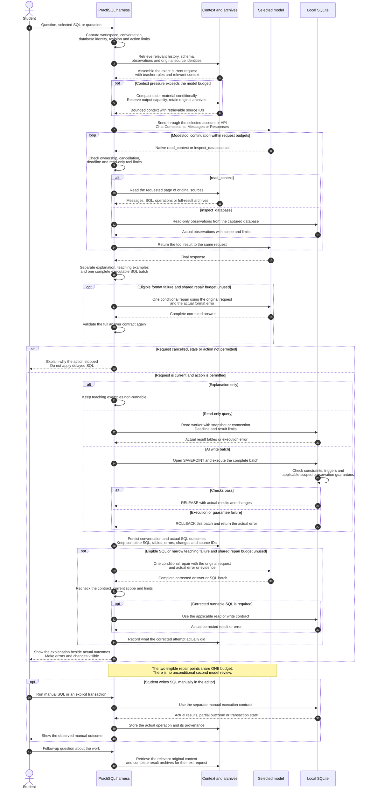

# Request flow

[English](../en/request-flow.md) · [Türkçe](../tr/request-flow.md)

Read from top to bottom. The model/tool loop, the execution branches and the single conditional repair are shown explicitly.

Scope and cancellation checks apply throughout asynchronous model/tool work. An AI write batch releases its savepoint only after the applicable checks; failures roll back that batch. Explicit transactions and manual commands have their own outcome/partial-state rules. A request does not receive a second model review by default; repair is conditional and shares one budget.

[Detailed architecture and source map](architecture.md)
