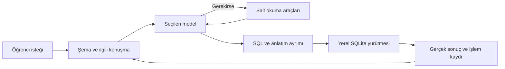

# PractiSQL nasıl çalışır?

PractiSQL, cihazda çalışan bir SQLite çalışma alanını isteğe bağlı bir AI öğretmenle birleştirir. Öğrenci sorusunu doğal dille anlatır; model SQL yöntemini seçer. Uygulama doğru bağlamı taşır, uygun SQL’i çalıştırır ve gerçekleşen sonucu konuşmaya geri bağlar.

[Etkileşimli mimari sunumu](../architecture/index.html?lang=tr) · [English architecture](../en/architecture.md) · [Akış görseli](../architecture/ai-harness.tr.svg)

Bu demoda sentetik perakende verileri kullanılır. SQL editörü ve sonuç tablosu yerel yürütmeyi gösterir; hazırlanmış öğretim mesajı konuşmanın bu sonuçları nasıl açıklayabileceğini örnekler. [Ekran görüntüsü galerisi](screenshots.md), 28 bölümü üç temada gösterir.

## Bir sorunun izlediği yol

| Aşama | Uygulamanın yaptığı |
|---|---|
| İstek | Çalışma alanını, sohbeti, DB revizyonunu, seçili kodu veya alıntıyı yakalar. |
| Bağlam | Öğretmen sözleşmesini, gerçek SQLite şemasını ve ilgili geçmişi hazırlar. Son soruyu korur. |
| Model | Kullanıcının niyetini yorumlar, SQL yöntemini ve anlatımı seçer. Gerektiğinde kanıt ister. |
| Araçlar | `read_context` kaydedilmiş kaynağı, `inspect_database` güncel kayıtları okur. |
| Yürütme | Okumalar kopya bağlantıdaki worker’da; normal AI yazma partileri savepoint ve ilgili denetimlerle çalışır. |
| Sonuç | Gerçek tablolar, hatalar, kısmi durumlar ve kaynak bilgisi kaydedilir; geçmiş sonuç yeni veriden uydurulmaz. |

Başarılı her cevap ikinci bir modele gönderilmez. Araç devamı, özetleme ve uygun hatada sınırlı onarım koşulludur. Manuel editör, açık transaction/bağlantı komutları, sınav ve proje ayrı yürütme sözleşmelerine sahiptir.

## Öğretim ve değerlendirme

Modelin görevi yalnız SQL üretmek değildir: kavramı açıklamak, örneği adımlandırmak ve uygun karşılaştırmalarda tablo kullanmaktır. Başlık ve Markdown desteği anlatımı okunur kılar; yöntem ve açıklamanın kapsamı tek bir sabit şablona sıkıştırılmaz.

SQL’in çalışması, doğru görev sonucunu vermesi ve açıklamanın doğru olması ayrı konulardır. Yerel kontroller gerçek SQLite kısıtlarını ve açık veri sınırlarını denetler; her iş yorumunu veya öğretim hatasını otomatik olarak yakaladıkları iddia edilmez.

## Ayrı öğrenme yolları

- **Dersler ve PDF:** Kendi öğretim verileri ve SQLite gözlemleri kullanılır. Üretilen ders SQL’i kişisel çalışma alanına kendiliğinden uygulanmaz.
- **Challenge:** Ayrı deneme DB’sinde, üç fixture çeşidinde kontrol edilir. Şema alanları ve örnek kayıtlar öğrenciye tablo olarak sunulur.
- **Sınav:** Soruların üretimi, cevapların kopyada yürütülmesi, bağlantı ayarlarının yakalanması ve notlandırma ayrı akıştır.
- **SQL alıştırmaları:** AI, sentetik ve tam sorgular üretir. Arayüz seçilen SQL ifadesini boşluğa çevirir; sözdizimini boş ve geçici SQLite bağlantısında kontrol eder. Anahtar kelime cevapları yerelde karşılaştırılır. Kişisel şema veya kayıtlar alıştırma isteğine girmez.
- **Veri projesi:** UCI kaynağı doğrulanır, iş sorusu netleştirilir, bağımsız çalışma alanı kurulur. Sayısal sonuçlar özgün kayıtlardan bağımsız hesaplanır; AI iş yorumunu kanıtlara bakarak değerlendirir. Ödül kararı uygulama kodundadır.

Sınavın şema görünümü, sınavla aynı sabitlenmiş veritabanı kopyasını kullanır. Boşluk doldurma sorusuna isteğe bağlı olarak verilen her doğru tam sorgu cevabı ek 25 XP kazandırır; soru setine bağlı ödül kaydı tekrar ödülü engeller. Alıştırmalarda 10, 15 veya 20 soru seçilebilir; öğrencinin cevabı bir veritabanında yürütülmez.

## Gizlilik ve güvenlik

SQL cihazda çalışır. AI özellikleri kullanıldığında soru, ilgili sohbet, şema ve gerektiğinde örnek/sonuç kayıtları seçilen sağlayıcıyla paylaşılabilir. Bu bilgi ilk kurulumun sağlayıcı adımında açıklanır; bağlantı ertelenebilir.

Kaydedilen API anahtarları OS korumalı kasada tutulur; Windows’ta DPAPI kullanılır. DB ve sohbet dosyaları varsayılan olarak şifrelenmez. CSP paketli kodu, WASM ve worker’ları desteklerken enjekte edilen JavaScript’i sınırlar; özel HTTP/HTTPS sağlayıcı adreslerini kapatmaz.

İmzalı yayın hattı hazırdır ancak gerçek yayıncı sertifikası henüz yoktur. Mevcut yerel kurucu imzasızdır. [Gizlilik açıklaması](../../PRIVACY.md), [teknik sınırlar](../../SECURITY.md) ve [yayın hazırlığı](../PUBLICATION.md) bu ayrımları açıklar.

## Sunumu kullanmak

`docs/architecture/index.html` dosyasını tarayıcıda aç. Türkçe/English seçimi, sekiz bölüm ve seçilebilir bileşenler çevrimdışı çalışır. Dil değişimi açık bölümü ve seçili bileşeni korur. GitHub’daki Markdown ve Mermaid şemaları doğrudan okunabilir; HTML için Pages yayını zorunlu değildir.

Yapılandırılmış kaynak `docs/architecture/architecture.json` içindedir. `npm run docs:build` sunumu ve iki dildeki SVG akışlarını yeniden üretir. `npm run test:docs` dil seçimini, ayrıntıları ve bağlantıları gizli bir Electron oturumunda doğrular.

Bu anlatım mevcut kodun sorumluluklarını belgeler. Diyagramlar tek başına doğruluk veya bütün modellerde başarı garantisi değildir.
