# İsteğin izlediği akış

[English](../en/request-flow.md) · [Türkçe](../tr/request-flow.md)

Bu, README’de kullanılan ayrıntılı akış görselidir. Numaralı ana yolu yukarıdan aşağıya oku; ayrıntıları incelemek için SVG’yi tam boy aç.

**Numaralı ana yolu yukarıdan aşağıya oku.** Yan dallar; gerektiğinde bağlamı özetlemeyi, istek kapsamındaki salt okuma araçlarını, geçersiz kalan isteği durdurmayı, ayrı okuma/AI yazma/elle SQL yollarını ve ortak tek düzeltme hakkını gösterir. Gerçek sonuç arşivleri sonraki soruların kaynaklarına döner. Bağımsız editör girişi bir model çağrısından geçmez.

[Mermaid kaynak dosyası](../architecture/request-lifecycle.tr.mmd)

İstek kapsamı ve iptal durumu, model ve araçların asenkron işlemleri boyunca kontrol edilir. AI yazma partisi ilgili denetimler geçilince SAVEPOINT’i tamamlar; hata olursa o parti geri alınır. Açık transaction ve manuel komutların sonuç/kısmi durum kuralları ayrıdır. Her cevap varsayılan olarak ikinci bir model incelemesine gönderilmez; düzeltme koşulludur ve ortak bir deneme hakkı kullanır.

[Ayrıntılı mimari ve kaynak kod eşlemesi](architecture.md)
