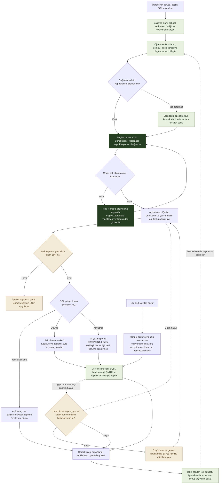

# İsteğin izlediği akış

[English](../en/request-flow.md) · [Türkçe](../tr/request-flow.md)

Akış yukarıdan aşağıya okunur. Modelin araçlarla devamı, farklı SQL yürütme yolları ve tek koşullu düzeltme açıkça gösterilir.

İstek kapsamı ve iptal durumu, model ve araçların asenkron işlemleri boyunca kontrol edilir. AI yazma partisi ilgili denetimler geçilince SAVEPOINT’i tamamlar; hata olursa o parti geri alınır. Açık transaction ve manuel komutların sonuç/kısmi durum kuralları ayrıdır. Her cevap varsayılan olarak ikinci bir model incelemesine gönderilmez; düzeltme koşulludur ve ortak bir deneme hakkı kullanır.

[Ayrıntılı mimari ve kaynak kod eşlemesi](architecture.md)
